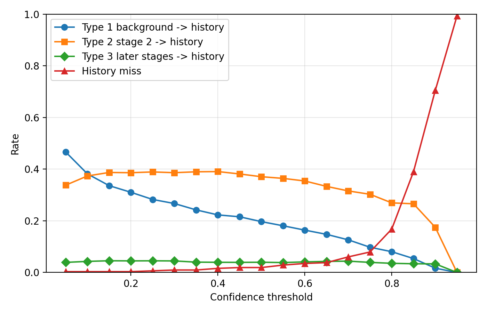
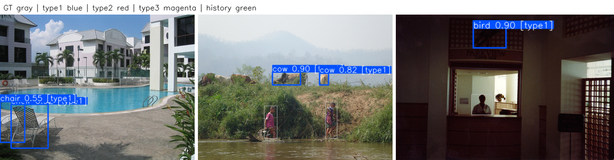
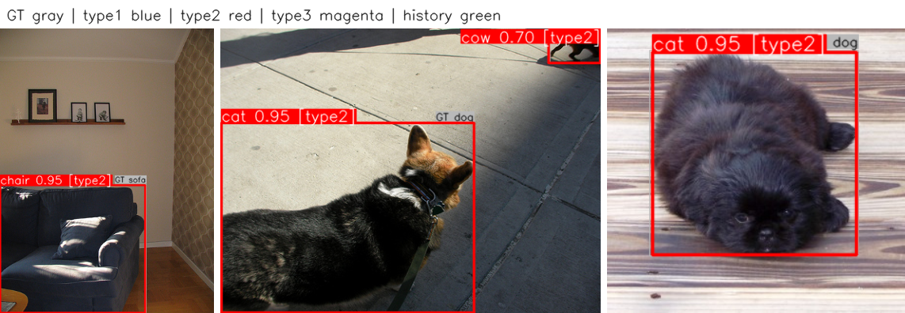
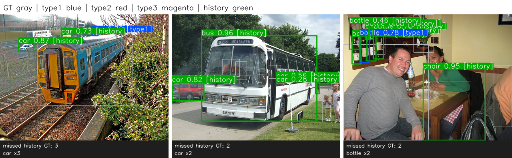
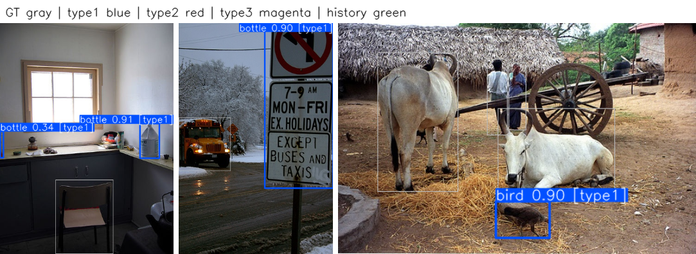
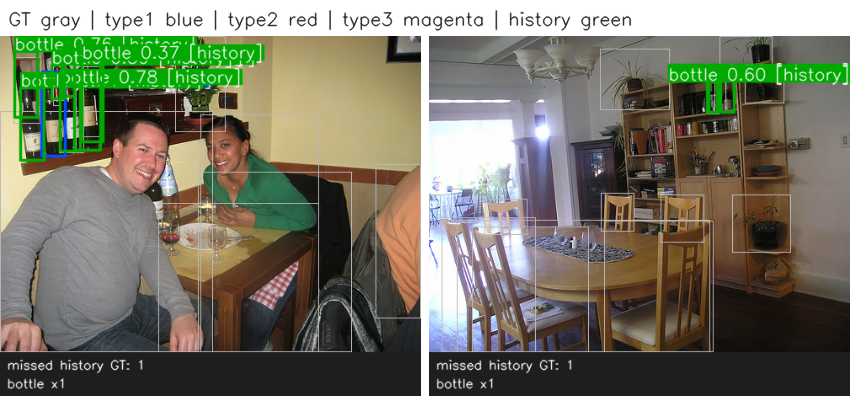

# 2026/09/06

截至目前，已经实现并且确认有效的IOD方法包括：伪标签（pseudo_label）, 蒸馏（Distillation），ESPReg 和 样本回放（Replay）。回放样本的挑选方法采用的是随机挑选。

在 VOC TINY 和 VOC 上基于 yolo26m，采用 yoloe-26m-seg.pt 预训练权重的实验结果如下（mAP50，task-agnostic）

VOC-TINY
|Method|old (15)|new (5)|all (20)|
|---|---|---|---|
|joint|82.6|81.6|82.4|
|dist|
|pseudo_label|
|pseudo_label+dist|58.0|65.1|59.8|
|pseudo_label+espreg|58.9|70.6|61.8|
|pseudo_label+espreg+dist|70.9|69.7|70.6|
|pseudo_label+espreg+replay|74.2|76.9|74.9|
|pseudo_label+espreg+dist+replay|74.0|67.6|72.4|

VOC
|Method|old (15)|new (5)|all (20)|
|---|---|---|---|
|joint|1.7|64.9|17.5|
|pseudo_label+espreg|74.7|74.1|74.5|
|pseudo_label+espreg+dist|83.6|74.3|81.2|
|pseudo_label+espreg+replay|83.1|76.8|81.6|
|pseudo_label+espreg+dist+replay|87.0|75.2|84.1|

超参数列表：

训练与解码（VOC / VOC-TINY 共用，来自 `scripts/voc/{tiny,all}/15+5/common.sh` 与各 run 的 `task-*/train/args.yaml`）

| 项 | 值 |
|---|---|
| 模型 / 预训练 | yolo26m / `yoloe-26m-seg.pt` |
| split | 15+5（CIL） |
| epochs | 10 |
| batch / imgsz / device / workers | 16 / 640 / 0 / 8 |
| optimizer / lr0 / lrf | AdamW / 0.001 / 0.01 |
| weight_decay / momentum | 0.0005 / 0.937 |
| warmup_epochs / warmup_bias_lr | 3.0 / 0.0 |
| mosaic / close_mosaic | 0.5 / 10 |
| freeze | 10（冻结前 10 层） |
| seed / deterministic | 0 / true |
| end2end / agnostic_nms / max_det | False / True / 300 |

IOD 组件（仅增量阶段 task-2 生效；未启用的组件为默认关闭）

| 项 | 值 |
|---|---|
| pseudo_label | conf_threshold=0.25，filter_iou_threshold=0.5 |
| dist | dist_loss_weight=100.0，dist_topk=1 |
| espreg | espreg_loss_weight=100.0（PCA cache 来自上一任务） |
| replay | 随机挑选，REPLAY_SAMPLE_NUM=100，replay_loss_weight=1.0，seed=0 |

# 2026/11/11

## Motivation 实验：阶段类别不平衡与教师模型的高置信度错误

对应 ICLR 审稿意见中 motivation 的实验组 1、2。两阶段协议使用 `VOC_10+10`，多阶段协议使用 `VOC_5+5+5+5`；模型为 yolo26m，预训练权重 `yolo26m-cls.pt`，训练 100 epoch，全部参数可训练。

### 0. 结论摘要

1. 阶段数据集按“吸收所有包含当前阶段训练类别的图像”构建，因此不同阶段的图像存在大量重叠（两阶段 stage-1/stage-2 共享 1844 张训练图像；多阶段 stage-2 与 stage-3 共享 1014 张）。图像重叠并不等于类别重叠：训练标注仍按阶段类别过滤。
2. 历史阶段训练图像中实际包含大量后续类别目标，但这些标注在训练时被过滤。两阶段 stage-1 图像中含 4424 个 stage-2 目标（其中 person 3084 个）；多阶段 stage-1 图像中含 2282 个后续阶段目标。这构成“历史任务阶段缺乏未来类别”的直接来源。
3. 增量阶段训练集几乎不含历史类别：多阶段 stage-2 的 8074 个 GT 中仅 315 个（3.9%）属于历史类；两阶段 stage-2 为 3587/15294（23.4%）。这构成“增量任务阶段缺乏历史类别”的直接来源。
4. 教师模型在增量阶段训练集上产生高置信度的历史类误报。conf ≥ 0.25 时，两阶段有 21.3% 的上报框把 stage-2 目标报成历史类；多阶段有 38.9% 把 stage-2 目标、4.5% 把 stage-3/4 目标报成历史类。conf ≥ 0.9 时，两阶段的第二类误报率仍为 7.2%，多阶段的第二类与第三类误报率合计仍为 20.8%。
5. 多阶段情形的教师错误显著强于两阶段：其 stage-2 训练集只有 3.9% 的历史类 GT，教师面对的 GT 有 96.1% 来自未见过类别。

### 1. 实验协议

#### 1.1 数据集构建

每个阶段吸收所有包含至少一个当前阶段训练类别的样本，排除不含任何当前阶段训练类别的样本；每个阶段独立保留 train / val / test 划分。同一图像可以同时进入多个阶段。

```bash
bash scripts/voc/motivation/create.sh
```

两阶段：`VOC_10+10`，stage-1 = aeroplane…cow（10 类），stage-2 = diningtable…tvmonitor（10 类）。
多阶段：`VOC_5+5+5+5`，按 VOC 类别顺序每 5 类一个阶段。

#### 1.2 训练配置

| 项 | 值 |
|---|---|
| 模型 / 预训练 | yolo26m / `yolo26m-cls.pt` |
| epochs / freeze | 100 / 无（全部参数可训练） |
| batch / imgsz / device / workers | 16 / 640 / 0 / 8 |
| optimizer / lr0 / lrf | AdamW / 0.001 / 0.01 |
| weight_decay / momentum | 0.0005 / 0.937 |
| warmup_epochs / warmup_bias_lr | 3.0 / 0.0 |
| mosaic / close_mosaic | 0.5 / 10 |
| seed / deterministic | 0 / true |
| end2end / agnostic_nms / max_det | False / True / 300 |

实验组 2 的教师即第一阶段模型；两阶段教师 stage-1 验证集 mAP50 = 78.2（10 类），多阶段教师 = 77.1（5 类）。

### 2. 实验组 1：阶段类别分布与样本交集

统计在完整 20 类标注空间下进行（`stage_stats/stage_class_counts.csv`），阶段样本交集在训练集上统计（`stage_stats/stage_sample_overlap.csv`）。

#### 2.1 各阶段类别目标数

两阶段（`VOC_10+10`，train）：

| Class | Stage 1 | Stage 2 |
|---|---:|---:|
| aeroplane | 583 | 38 |
| bicycle | 529 | 364 |
| bird | 803 | 56 |
| boat | 566 | 161 |
| bottle | 882 | 619 |
| bus | 407 | 165 |
| car | 1638 | 684 |
| cat | 791 | 121 |
| chair | 1578 | 1302 |
| cow | 426 | 77 |
| diningtable | 322 | 407 |
| dog | 123 | 1009 |
| horse | 43 | 532 |
| motorbike | 102 | 524 |
| person | 3084 | 6552 |
| pottedplant | 283 | 732 |
| sheep | 25 | 530 |
| sofa | 173 | 405 |
| train | 27 | 458 |
| tvmonitor | 242 | 558 |

多阶段（`VOC_5+5+5+5`，train）：

| Class | Stage 1 | Stage 2 | Stage 3 | Stage 4 |
|---|---:|---:|---:|---:|
| aeroplane | 583 | 18 | 37 | 1 |
| bicycle | 529 | 79 | 350 | 28 |
| bird | 803 | 7 | 53 | 5 |
| boat | 566 | 34 | 155 | 8 |
| bottle | 882 | 177 | 579 | 167 |
| bus | 18 | 407 | 163 | 3 |
| car | 137 | 1638 | 638 | 62 |
| cat | 17 | 791 | 79 | 58 |
| chair | 192 | 1578 | 1025 | 605 |
| cow | 8 | 426 | 75 | 2 |
| diningtable | 112 | 250 | 407 | 108 |
| dog | 32 | 97 | 1009 | 85 |
| horse | 4 | 39 | 532 | 7 |
| motorbike | 26 | 85 | 524 | 8 |
| person | 1548 | 1820 | 6552 | 984 |
| pottedplant | 72 | 241 | 307 | 732 |
| sheep | 12 | 13 | 95 | 530 |
| sofa | 38 | 146 | 188 | 405 |
| train | 3 | 24 | 106 | 458 |
| tvmonitor | 63 | 204 | 196 | 558 |

#### 2.2 阶段间训练样本交集

两阶段：

| Stage | Total train samples | Stage 1 | Stage 2 |
|---|---:|---:|---:|
| Stage 1 | 4824 | 4824 | 1844 |
| Stage 2 | 5238 | 1844 | 5238 |

多阶段：

| Stage | Total train samples | Stage 1 | Stage 2 | Stage 3 | Stage 4 |
|---|---:|---:|---:|---:|---:|
| Stage 1 | 2211 | 2211 | 210 | 713 | 131 |
| Stage 2 | 2823 | 210 | 2823 | 1014 | 385 |
| Stage 3 | 4171 | 713 | 1014 | 4171 | 595 |
| Stage 4 | 1662 | 131 | 385 | 595 | 1662 |

#### 2.3 结果分析

- 图像层面重叠明显：两阶段 stage-2 训练集有 1844 张图像同时属于 stage-1（占 stage-2 的 35.2%）；多阶段 stage-2 与 stage-3 共享 1014 张（占 stage-2 的 35.9%）。因此“新阶段”并不是全新场景，类别监督的缺失不能由场景新颖性解释。
- 标注层面高度不平衡：多阶段 stage-2 训练集的 8074 个 GT 中，历史类仅 315 个（3.9%），stage-2 类 4840 个（59.9%），stage-3/4 类 2919 个（36.2%）；两阶段 stage-2 为历史类 3587 个（23.4%）、stage-2 类 11707 个（76.6%）。
- 历史阶段训练图像中实际含有后续类别目标：两阶段 stage-1 图像中 stage-2 类目标合计 4424 个（person 3084 个）；多阶段 stage-1 图像中后续阶段类目标合计 2282 个（person 1548 个）。这些目标在历史阶段训练时被过滤掉，教师将其视作背景，是后续高置信度误报的来源。
- 类别频率差异很大：多阶段 stage-3 中 person 有 6552 个目标，而 stage-4 的 train 类只有 458 个；两阶段 stage-2 中 person 占该阶段 GT 的 56.0%（6552/11707）。

结果文件：[两阶段类别计数](runs/yolo26m_VOC_10+10_pretrained-from-yolo26m-cls_naive/stage_stats/stage_class_counts.md) · [两阶段样本交集](runs/yolo26m_VOC_10+10_pretrained-from-yolo26m-cls_naive/stage_stats/stage_sample_overlap.md) · [多阶段类别计数](runs/yolo26m_VOC_5+5+5+5_pretrained-from-yolo26m-cls_naive/stage_stats/stage_class_counts.md) · [多阶段样本交集](runs/yolo26m_VOC_5+5+5+5_pretrained-from-yolo26m-cls_naive/stage_stats/stage_sample_overlap.md)

### 3. 实验组 2：教师模型的高置信度错误

#### 3.1 统计口径

教师为第一阶段训练后的基础模型，在第二阶段训练集上推理。GT 使用完整 20 类空间标注；每个上报框按 IoU 最大的 GT 归类：

- 第一类误报：与任何 GT 的 IoU 都不大于 0.5（完整类别空间下的背景→历史类）；
- 第二类误报：与 GT 的 IoU 大于 0.5，且该 GT 属于第二阶段（第二阶段→历史类）；
- 第三类误报：与 GT 的 IoU 大于 0.5，且该 GT 属于第三阶段及以后（后续阶段→历史类）；
- 漏检：没有任何上报框与其 IoU 大于 0.5 的历史类 GT 目标（只统计教师见过的类别）。

误报率以上报检测框总数为分母，漏检率以历史类 GT 总数为分母。IoU 阈值默认 0.5。置信度扫描为 0.05–0.95、步长 0.05，**包含 Ultralytics 默认推理阈值 0.25**。

```bash
bash scripts/voc/motivation/teacher_errors.sh
```

#### 3.2 两阶段结果

第二阶段训练集 5238 张；GT 15294 个（历史 3587 / 第二阶段 11707 / 未来 0）。

| Conf | 上报框 | 第一类误报率 | 第二类误报率 | 第三类误报率 | 历史类漏检率 |
|---:|---:|---:|---:|---:|---:|
| 0.05 | 8383 | 33.3% | 21.2% | 0.0% | 0.5% |
| 0.10 | 6876 | 24.1% | 22.2% | 0.0% | 0.7% |
| 0.25 | 5577 | 14.8% | 21.3% | 0.0% | 1.2% |
| 0.50 | 4703 | 8.2% | 18.2% | 0.0% | 2.6% |
| 0.70 | 4095 | 4.5% | 14.5% | 0.0% | 6.5% |
| 0.90 | 1912 | 0.5% | 7.2% | 0.0% | 50.2% |


两阶段没有第三阶段及以后的类别，因此第三类误报率恒为 0。第二类误报率在 conf 0.10–0.25 附近达到约 21%–22%，随后缓慢下降；即使 conf ≥ 0.90，仍有 7.2% 的上报框把未见过的 stage-2 目标报成历史类（137/1912）。第一类误报率随阈值上升快速下降（33.3% → 0.5%）。历史类漏检率在 conf 0.05–0.50 仅为 0.5%–2.6%，说明教师对已见过的历史类物体在增量训练集上仍保持很高召回；conf 0.90 时升至 50.2%（conf 0.95 为 96.0%），主要因为上报框数量骤减。

逐阈值原始计数与全部指标：[error_rates.csv](runs/yolo26m_VOC_10+10_pretrained-from-yolo26m-cls_naive/teacher_errors/task_2/error_rates.csv) · [summary.txt](runs/yolo26m_VOC_10+10_pretrained-from-yolo26m-cls_naive/teacher_errors/task_2/summary.txt)

#### 3.3 多阶段结果

第二阶段训练集 2823 张；GT 8074 个（历史 315 / 第二阶段 4840 / 未来 2919）。

| Conf | 上报框 | 第一类误报率 | 第二类误报率 | 第三类误报率 | 历史类漏检率 |
|---:|---:|---:|---:|---:|---:|
| 0.05 | 2100 | 46.7% | 33.8% | 3.9% | 0.3% |
| 0.10 | 1608 | 38.2% | 37.4% | 4.3% | 0.3% |
| 0.25 | 1107 | 28.3% | 38.9% | 4.5% | 0.6% |
| 0.50 | 782 | 19.7% | 37.1% | 4.0% | 1.9% |
| 0.70 | 570 | 12.6% | 31.6% | 4.4% | 6.0% |
| 0.90 | 120 | 1.7% | 17.5% | 3.3% | 70.5% |



多阶段的第二类误报率在 conf 0.25 为 38.9%，在 conf 0.30–0.45 维持在约 38%–39%，conf 0.90 仍有 17.5%；第三类误报率在 conf 0.05–0.90 稳定在 3.3%–4.5%。也就是说，高置信度上报框中有相当比例来自教师完全未见过、且属于不同后续阶段的类别。相比两阶段，多阶段的第二类误报率约高一倍，第三类误报持续存在，原因与其 stage-2 训练集只有 3.9% 的历史类 GT 直接对应。历史类漏检率在 conf 0.05–0.50 为 0.3%–1.9%，conf 0.70 为 6.0%，conf 0.90 升至 70.5%，趋势与两阶段一致。

逐阈值原始计数与全部指标：[error_rates.csv](runs/yolo26m_VOC_5+5+5+5_pretrained-from-yolo26m-cls_naive/teacher_errors/task_2/error_rates.csv) · [summary.txt](runs/yolo26m_VOC_5+5+5+5_pretrained-from-yolo26m-cls_naive/teacher_errors/task_2/summary.txt)

#### 3.4 典型错误可视化样例

样例在 conf ≥ 0.25 下按错误类型挑选：第一、二、三类取该类型中置信度最高的上报框（每张图至多一个），其中第一类样例额外要求上报框与任何 GT 都没有交集，以便展示纯背景误报；漏检取漏检历史类 GT 数最多的图像。灰框为 GT；蓝框为第一类误报，红框为第二类误报，品红框为第三类误报，绿框为匹配到历史类 GT 的上报框。逐图清单见各协议的 `examples/examples.csv`。

**两阶段 · 第一类误报（背景→历史类）**



三个样例分别为 `chair 0.92`（泳池边椅子）、`cow 0.90`（田间牛群）、`bird 0.90`（墙面装饰），均与完整标注空间中的任何 GT 都没有交集。需要说明：VOC 标注未覆盖的物体（如未被标注的椅子、牛）在统计上同样属于“完整类别空间下的背景”，第一类误报的视觉样例因此会包含这类漏标物体。

单张样例：[01](docs/images/motivation/two_stage_type1_01.png) · [02](docs/images/motivation/two_stage_type1_02.png) · [03](docs/images/motivation/two_stage_type1_03.png)

**两阶段 · 第二类误报（第二阶段→历史类）**



三个样例为 `chair 0.95`（GT 为 sofa）、`cat 0.95`（GT 为 dog）、`cat 0.95`（GT 为 dog）。教师对从未作为正类训练的沙发、狗给出高置信度的历史类框，而对应的 stage-2 GT 被完全错误命名。

单张样例：[01](docs/images/motivation/two_stage_type2_01.png) · [02](docs/images/motivation/two_stage_type2_02.png) · [03](docs/images/motivation/two_stage_type2_03.png)

**两阶段 · 漏检**



三个样例分别有 3、2、2 个漏检的历史类 GT（car x3；car x2；bottle x2），图中灰框为全部 GT，底部文字给出漏检的历史类构成；可见教师在这几张图上漏掉了 car、bottle 等历史类物体，同时仍能检出部分历史类物体（绿框）。

单张样例：[01](docs/images/motivation/two_stage_miss_01.png) · [02](docs/images/motivation/two_stage_miss_02.png) · [03](docs/images/motivation/two_stage_miss_03.png)

**多阶段 · 第一类误报（背景→历史类）**



三个样例为 `bottle 0.91`（厨房窗台瓶子）、`bottle 0.90`（路牌）、`bird 0.90`（田间鸡）。其中路牌样例是典型的纯背景误报，另外两个对应 VOC 未标注物体。

单张样例：[01](docs/images/motivation/four_stage_type1_01.png) · [02](docs/images/motivation/four_stage_type1_02.png) · [03](docs/images/motivation/four_stage_type1_03.png)

**多阶段 · 第二类误报（第二阶段→历史类）**


三个样例为 `bird 0.93`（GT 为 cat）、`bird 0.93`（GT 为 cow）、`bird 0.93`（GT 为 cow，剪影）。教师把 stage-2 的猫、牛稳定地报成历史类 bird。

单张样例：[01](docs/images/motivation/four_stage_type2_01.png) · [02](docs/images/motivation/four_stage_type2_02.png) · [03](docs/images/motivation/four_stage_type2_03.png)

**多阶段 · 第三类误报（第三阶段及以后→历史类）**


三个样例为 `bird 0.93`（GT 为 dog，stage-3）、`bicycle 0.92`（GT 为 motorbike，stage-3）、`bicycle 0.90`（GT 为 motorbike，stage-3）。教师把后续阶段的狗、摩托车高置信度地报成历史类 bird/bicycle；这类错误在多阶段增量中会持续污染后续阶段的蒸馏信号。

单张样例：[01](docs/images/motivation/four_stage_type3_01.png) · [02](docs/images/motivation/four_stage_type3_02.png) · [03](docs/images/motivation/four_stage_type3_03.png)

**多阶段 · 漏检**



conf 0.25 下多阶段教师只漏掉 2 个历史类 GT，分布在两个样例中（bottle x1；bottle x1）。图中灰框为全部 GT，底部文字给出漏检的历史类构成；可见历史类漏检在此阈值下已经很少。

单张样例：[01](docs/images/motivation/four_stage_miss_01.png) · [02](docs/images/motivation/four_stage_miss_02.png)

#### 3.5 结果分析

- 高置信度误报是稳定的：两阶段在 conf ≥ 0.50 时仍有 18.2% 的上报框把 stage-2 目标报成历史类，conf ≥ 0.90 时为 7.2%；多阶段对应为 37.1% 和 17.5%，另有 4.0% 和 3.3% 的第三类误报。误报率并非只由低置信度长尾贡献。
- 多阶段的教师错误明显更强：其 stage-2 训练集只有 315 个历史类 GT（3.9%），教师面对的对象主要来自未见过类别；两阶段该比例为 23.4%。这与多阶段更高的第二类误报率和持续存在的第三类误报一致。
- 第一类误报随阈值上升而快速衰减（两阶段 33.3%→0.5%，多阶段 46.7%→1.7%），说明纯背景误报主要来自低置信度长尾；高置信度误报主要是“把未见过的物体报成历史类”。
- 历史类漏检率在常规阈值下很低（conf 0.05–0.50：两阶段 0.5%–2.6%，多阶段 0.3%–1.9%；conf 0.70：6.5% / 6.0%），说明教师在本阶段数据上对已见过的历史类物体仍保持较高召回；conf 0.90 时升至 50.2% / 70.5%，主要是上报框数量骤减所致。因此教师的高置信度错误主要表现为“把未见过类别报成历史类”，而不是“漏掉历史类”。
- 第一类误报的可视化包含 VOC 漏标物体，这是“以完整标注空间定义背景”的必然结果；统计口径本身严格按 GT 判定，未引入额外过滤。

### 4. 产物与复现

实现组件：

- `tools/stage_dataset_stats.py`：实验组 1 的类别目标数与阶段样本交集（`scripts/analyze.sh stage_stats`）。
- `tools/teacher_error_analysis.py`：实验组 2 的四类错误统计、曲线与典型样例（`scripts/analyze.sh teacher_errors`，`--vis_dir` / `--vis_conf` / `--vis_per_type`）。
- `scripts/voc/motivation/`：`common.sh` 集中协议与训练/分析参数，`create.sh` / `stats.sh` / `train.sh` / `teacher_errors.sh` / `pipeline.sh` 可单独运行或串联。

```bash
bash scripts/voc/motivation/create.sh        # 构建两个协议的阶段数据集
bash scripts/voc/motivation/stats.sh         # 实验组 1
PROTOCOL=two  EPOCHS=100 bash scripts/voc/motivation/train.sh
PROTOCOL=four EPOCHS=100 bash scripts/voc/motivation/train.sh
bash scripts/voc/motivation/teacher_errors.sh  # 实验组 2（含典型样例）
```

本次实验组 2 只依赖第一阶段教师，因此两个 run 目录当前包含 `task-1`；如需补齐后续增量阶段，使用 `START_TASK=2` 继续同一 run：

```bash
PROTOCOL=two  START_TASK=2 bash scripts/voc/motivation/train.sh
PROTOCOL=four START_TASK=2 bash scripts/voc/motivation/train.sh
```

结果目录：

- `runs/yolo26m_VOC_10+10_pretrained-from-yolo26m-cls_naive/`
- `runs/yolo26m_VOC_5+5+5+5_pretrained-from-yolo26m-cls_naive/`

每个协议下：`stage_stats/`（实验组 1 表格）、`task-1/best.pt`（教师）、`teacher_errors/task_2/error_rates.{csv,md,png}`、`teacher_errors/task_2/summary.txt`、`teacher_errors/task_2/examples/`（典型样例与 `examples.csv`）。

本报告引用的曲线与样例图已归档到 `docs/images/motivation/`。
