# 2026/09/06

截至目前，已经实现并且确认有效的IOD方法包括：伪标签（pseudo_label）, 蒸馏（Distillation），ESPReg 和 样本回放（Replay）。回放样本的挑选方法采用的是随机挑选。

在 VOC TINY 和 VOC 上基于 yolo26m，采用 yoloe-26m-seg.pt 预训练权重的实验结果如下（mAP50，task-agnostic）

VOC-TINY
|Method|old (15)|new (5)|all (20)|
|---|---|---|---|
|joint|82.6|81.6|82.4|
|dist|
|pseudo_label|
|pseudo_label+dist|58.0|65.1|59.8|
|pseudo_label+espreg|58.9|70.6|61.8|
|pseudo_label+espreg+dist|70.9|69.7|70.6|
|pseudo_label+espreg+replay|74.2|76.9|74.9|
|pseudo_label+espreg+dist+replay|74.0|67.6|72.4|

VOC
|Method|old (15)|new (5)|all (20)|
|---|---|---|---|
|joint|1.7|64.9|17.5|
|pseudo_label+espreg|74.7|74.1|74.5|
|pseudo_label+espreg+dist|83.6|74.3|81.2|
|pseudo_label+espreg+replay|83.1|76.8|81.6|
|pseudo_label+espreg+dist+replay|87.0|75.2|84.1|

超参数列表：

训练与解码（VOC / VOC-TINY 共用，来自 `scripts/voc/{tiny,all}/15+5/common.sh` 与各 run 的 `task-*/train/args.yaml`）

| 项 | 值 |
|---|---|
| 模型 / 预训练 | yolo26m / `yoloe-26m-seg.pt` |
| split | 15+5（CIL） |
| epochs | 10 |
| batch / imgsz / device / workers | 16 / 640 / 0 / 8 |
| optimizer / lr0 / lrf | AdamW / 0.001 / 0.01 |
| weight_decay / momentum | 0.0005 / 0.937 |
| warmup_epochs / warmup_bias_lr | 3.0 / 0.0 |
| mosaic / close_mosaic | 0.5 / 10 |
| freeze | 10（冻结前 10 层） |
| seed / deterministic | 0 / true |
| end2end / agnostic_nms / max_det | False / True / 300 |

IOD 组件（仅增量阶段 task-2 生效；未启用的组件为默认关闭）

| 项 | 值 |
|---|---|
| pseudo_label | conf_threshold=0.25，filter_iou_threshold=0.5 |
| dist | dist_loss_weight=100.0，dist_topk=1 |
| espreg | espreg_loss_weight=100.0（PCA cache 来自上一任务） |
| replay | 随机挑选，REPLAY_SAMPLE_NUM=100，replay_loss_weight=1.0，seed=0 |

# 2026-11-11 → 2026-11-13：动机实验

本板块汇总 2026-11-11 起至今的全部 motivation 实验数据，**按修改大纲中的实验顺序**组织：数据集构造与模型训练 → 实验组 1（阶段类别分布）→ 实验组 2（教师高置信度错误的普遍性与严重性，含基础模型与 Joint 对照）→ 实验组 3（增量模型在历史任务上的高置信度错误）。时间线、结论摘要与产物索引统一放在最后的 §5“整理”。

## 1. 数据集构造与模型训练

### 1.1 数据集构建

每个阶段吸收所有包含至少一个当前阶段训练类别的样本，排除不含任何当前阶段训练类别的样本；每个阶段独立保留 train / val / test 划分。同一图像可以同时进入多个阶段。

```bash
bash scripts/voc/motivation/create.sh
```

两阶段：`VOC_10+10`，stage-1 = aeroplane…cow（10 类），stage-2 = diningtable…tvmonitor（10 类）。
多阶段：`VOC_5+5+5+5`，按 VOC 类别顺序每 5 类一个阶段。

### 1.2 训练配置

| 项 | 值 |
|---|---|
| 模型 / 预训练 | yolo26m / `yolo26m-cls.pt` |
| epochs / freeze | 100 / 无（全部参数可训练） |
| batch / imgsz / device / workers | 16 / 640 / 0 / 8 |
| optimizer / lr0 / lrf | AdamW / 0.001 / 0.01 |
| weight_decay / momentum | 0.0005 / 0.937 |
| warmup_epochs / warmup_bias_lr | 3.0 / 0.0 |
| mosaic / close_mosaic | 0.5 / 10 |
| seed / deterministic | 0 / true |
| end2end / agnostic_nms / max_det | False / True / 300 |

实验组 2 的教师即第一阶段模型；两阶段教师 stage-1 验证集 mAP50 = 78.2（10 类），多阶段教师 = 77.1（5 类）。

### 1.3 主结果汇总

两阶段协议（VOC 10+10）的主结果表在 §4.1；下表为多阶段协议（VOC 5+5+5+5）的主结果汇总，两种协议都包含 Joint（单阶段联合训练）上界行。

5+5+5+5 的 stage-3、stage-4 于 11-12 → 11-13 补齐（阶段 1–2 见 §4.1）；YOLO-LwF 的 stage-k 教师为 stage-(k−1) 模型，stage-1 不做蒸馏，因此与 naive 共用同一 stage-1 checkpoint。训练配置与 §1.2 完全相同。

下表分别为 mAP50（%）与 mAP50-95（%），任务未知评测（完整类别空间检测头，只统计当前测试集有标注的类别）：

- **test-k**：第 k 阶段测试集上、第 k 阶段类别的精度（`model_k_eval_task_k`）；
- **seen-4-task-k**：四阶段累积测试集（`task_1-4_cls_20`，20 类全量测试集）上、第 k 阶段类别的精度（`model_k_eval_cumulative_4`）；
- “—” 表示该阶段模型尚未见过第 k 阶段类别，评测脚本输出空表，不要读作 0。

**mAP50**

| 方法 | 阶段 | test-1 | test-2 | test-3 | test-4 | seen-4-task-1 | seen-4-task-2 | seen-4-task-3 | seen-4-task-4 |
|---|---|---:|---:|---:|---:|---:|---:|---:|---:|
| Joint | 单阶段 | 82.4 | 84.5 | 85.8 | 79.7 | 81.0 | 82.4 | 84.9 | 76.5 |
| naive | s1 | 81.9 | — | — | — | 70.7 | — | — | — |
| naive | s2 | 0.0 | 82.7 | — | — | 0.0 | 67.1 | — | — |
| naive | s3 | 0.0 | 0.0 | 86.0 | — | 0.0 | 0.0 | 76.2 | — |
| naive | s4 | 0.0 | 0.0 | 0.0 | 78.9 | 0.0 | 0.0 | 0.0 | 48.7 |
| YOLO-LwF | s1 | 81.9 | — | — | — | 70.7 | — | — | — |
| YOLO-LwF | s2 | 75.6 | 81.4 | — | — | 69.0 | 69.0 | — | — |
| YOLO-LwF | s3 | 69.3 | 79.5 | 82.4 | — | 65.1 | 71.2 | 76.0 | — |
| YOLO-LwF | s4 | 52.6 | 60.4 | 72.0 | 76.8 | 48.9 | 52.7 | 69.1 | 52.1 |

**mAP50-95**

| 方法 | 阶段 | test-1 | test-2 | test-3 | test-4 | seen-4-task-1 | seen-4-task-2 | seen-4-task-3 | seen-4-task-4 |
|---|---|---:|---:|---:|---:|---:|---:|---:|---:|
| Joint | 单阶段 | 57.8 | 65.8 | 63.2 | 58.3 | 56.8 | 64.4 | 62.6 | 56.3 |
| naive | s1 | 55.8 | — | — | — | 49.0 | — | — | — |
| naive | s2 | 0.0 | 62.2 | — | — | 0.0 | 51.6 | — | — |
| naive | s3 | 0.0 | 0.0 | 62.2 | — | 0.0 | 0.0 | 55.6 | — |
| naive | s4 | 0.0 | 0.0 | 0.0 | 58.0 | 0.0 | 0.0 | 0.0 | 36.0 |
| YOLO-LwF | s1 | 55.8 | — | — | — | 49.0 | — | — | — |
| YOLO-LwF | s2 | 49.6 | 60.9 | — | — | 45.8 | 52.7 | — | — |
| YOLO-LwF | s3 | 45.2 | 59.0 | 58.4 | — | 42.9 | 53.6 | 54.0 | — |
| YOLO-LwF | s4 | 31.8 | 40.3 | 48.4 | 54.5 | 30.0 | 36.4 | 46.7 | 38.1 |

### 1.4 逐阶段分析

- **新类精度基本不受抗遗忘策略影响**：各阶段模型的 test-k 都在 76.8–86.0（mAP50），YOLO-LwF 相对 naive 的代价在最后阶段收敛到 2.1 点（76.8 vs 78.9），自蒸馏没有以牺牲可塑性为代价。
- **旧类保持的差距随阶段数放大**：naive 从 s2 起旧类 mAP 归零（test-1 与 seen-4-task-1 均为 0.0），YOLO-LwF 的 test-1 为 81.9 → 75.6 → 69.3 → 52.6，seen-4-task-1 为 70.7 → 69.0 → 65.1 → 48.9；Joint 上界恒为 82.4 / 81.0。多阶段累计遗忘在 LwF 上表现为每阶段约 −6 至 −17 点的持续衰减。
- **后阶段模型对早阶段类别的整体标记能力也在退化**：LwF s4 的 test-2、test-3 分别为 60.4、72.0，明显低于各阶段自身模型的 81.4、82.4；seen-4 的同一现象为 52.7、69.1 vs 69.0、76.0。即遗忘不是“完全不报”，而是“报得越来越弱”，这与 §3.3、§3.5 中“背景→历史类误报持续存在、历史类漏检上升”的现象互为表里。
- **累积全类精度（seen-4 的 All）最能体现差距**：naive 12.2 / 9.0、YOLO-LwF 55.7 / 37.8、Joint 81.2 / 60.0（mAP50 / mAP50-95）。LwF 把“完全忘记”变成“缓慢衰减”，但离上界仍有 25.5 点（mAP50）。
- **衰减最陡的一次出现在 s3→s4**（test-1：69.3 → 52.6）：stage-4 只有 1662 张训练图像、历史类 GT 极少（见 §2.1 的类别计数），与“增量阶段缺乏历史类别 → 旧类被淹没”的动机一致。
- 与实验组 2、3 互相印证：第一类（背景→历史类）与第三类（未来阶段→历史类）误报在 LwF 上持续存在，多阶段情形下的累积效应正是旧类精度逐阶段下滑的直接原因。

## 2. 实验组 1：阶段类别分布与样本交集

统计在完整 20 类标注空间下进行（`stage_stats/stage_class_counts.csv`），阶段样本交集在训练集上统计（`stage_stats/stage_sample_overlap.csv`）。

### 2.1 各阶段类别目标数

两阶段（`VOC_10+10`，train）：

| Class | Stage 1 | Stage 2 |
|---|---:|---:|
| aeroplane | 583 | 38 |
| bicycle | 529 | 364 |
| bird | 803 | 56 |
| boat | 566 | 161 |
| bottle | 882 | 619 |
| bus | 407 | 165 |
| car | 1638 | 684 |
| cat | 791 | 121 |
| chair | 1578 | 1302 |
| cow | 426 | 77 |
| diningtable | 322 | 407 |
| dog | 123 | 1009 |
| horse | 43 | 532 |
| motorbike | 102 | 524 |
| person | 3084 | 6552 |
| pottedplant | 283 | 732 |
| sheep | 25 | 530 |
| sofa | 173 | 405 |
| train | 27 | 458 |
| tvmonitor | 242 | 558 |

多阶段（`VOC_5+5+5+5`，train）：

| Class | Stage 1 | Stage 2 | Stage 3 | Stage 4 |
|---|---:|---:|---:|---:|
| aeroplane | 583 | 18 | 37 | 1 |
| bicycle | 529 | 79 | 350 | 28 |
| bird | 803 | 7 | 53 | 5 |
| boat | 566 | 34 | 155 | 8 |
| bottle | 882 | 177 | 579 | 167 |
| bus | 18 | 407 | 163 | 3 |
| car | 137 | 1638 | 638 | 62 |
| cat | 17 | 791 | 79 | 58 |
| chair | 192 | 1578 | 1025 | 605 |
| cow | 8 | 426 | 75 | 2 |
| diningtable | 112 | 250 | 407 | 108 |
| dog | 32 | 97 | 1009 | 85 |
| horse | 4 | 39 | 532 | 7 |
| motorbike | 26 | 85 | 524 | 8 |
| person | 1548 | 1820 | 6552 | 984 |
| pottedplant | 72 | 241 | 307 | 732 |
| sheep | 12 | 13 | 95 | 530 |
| sofa | 38 | 146 | 188 | 405 |
| train | 3 | 24 | 106 | 458 |
| tvmonitor | 63 | 204 | 196 | 558 |

### 2.2 阶段间训练样本交集

两阶段：

| Stage | Total train samples | Stage 1 | Stage 2 |
|---|---:|---:|---:|
| Stage 1 | 4824 | 4824 | 1844 |
| Stage 2 | 5238 | 1844 | 5238 |

多阶段：

| Stage | Total train samples | Stage 1 | Stage 2 | Stage 3 | Stage 4 |
|---|---:|---:|---:|---:|---:|
| Stage 1 | 2211 | 2211 | 210 | 713 | 131 |
| Stage 2 | 2823 | 210 | 2823 | 1014 | 385 |
| Stage 3 | 4171 | 713 | 1014 | 4171 | 595 |
| Stage 4 | 1662 | 131 | 385 | 595 | 1662 |

### 2.3 结果分析

- 图像层面重叠明显：两阶段 stage-2 训练集有 1844 张图像同时属于 stage-1（占 stage-2 的 35.2%）；多阶段 stage-2 与 stage-3 共享 1014 张（占 stage-2 的 35.9%）。因此“新阶段”并不是全新场景，类别监督的缺失不能由场景新颖性解释。
- 标注层面高度不平衡：多阶段 stage-2 训练集的 8074 个 GT 中，历史类仅 315 个（3.9%），stage-2 类 4840 个（59.9%），stage-3/4 类 2919 个（36.2%）；两阶段 stage-2 为历史类 3587 个（23.4%）、stage-2 类 11707 个（76.6%）。
- 历史阶段训练图像中实际含有后续类别目标：两阶段 stage-1 图像中 stage-2 类目标合计 4424 个（person 3084 个）；多阶段 stage-1 图像中后续阶段类目标合计 2282 个（person 1548 个）。这些目标在历史阶段训练时被过滤掉，教师将其视作背景，是后续高置信度误报的来源。
- 类别频率差异很大：多阶段 stage-3 中 person 有 6552 个目标，而 stage-4 的 train 类只有 458 个；两阶段 stage-2 中 person 占该阶段 GT 的 56.0%（6552/11707）。

结果文件：[两阶段类别计数](runs/yolo26m_VOC_10+10_pretrained-from-yolo26m-cls_naive/stage_stats/stage_class_counts.md) · [两阶段样本交集](runs/yolo26m_VOC_10+10_pretrained-from-yolo26m-cls_naive/stage_stats/stage_sample_overlap.md) · [多阶段类别计数](runs/yolo26m_VOC_5+5+5+5_pretrained-from-yolo26m-cls_naive/stage_stats/stage_class_counts.md) · [多阶段样本交集](runs/yolo26m_VOC_5+5+5+5_pretrained-from-yolo26m-cls_naive/stage_stats/stage_sample_overlap.md)

## 3. 实验组 2：教师模型高置信度错误的普遍性与严重性

按修改大纲，本实验组包含两部分，并**按协议分别给出**（先看教师本身的误报，再看它在训练后模型上的延续）：

1. **普遍性**：阶段一模型（下称基础模型 / 教师）在**阶段二训练集**上推理，统计其把背景、第二阶段目标（多阶段还有第三阶段及以后目标）报成历史类的比例与阈值关系（§3.2、§3.4）。
2. **严重性**：随后用训练后的模型在**阶段一测试集、阶段二测试集、前两阶段累积测试集**上评估同类误报（§3.3、§3.5）。参与对照的模型包括：基础模型（只训练第一阶段，即增量之前的参照）、naive 与 YOLO-LwF（分别训练完两阶段 / 前两阶段；YOLO-LwF 不含 replay）、Joint（全 20 类单阶段联合训练，同超参、同初始化，作为上限）。其中第一类（背景→历史类）与第三类（第三阶段及以后→历史类）是重点。

### 3.1 统计口径

教师为第一阶段训练后的基础模型，在第二阶段训练集上推理。GT 使用完整 20 类空间标注；每个上报框按 IoU 最大的 GT 归类：

- 第一类误报：与任何 GT 的 IoU 都不大于 0.5（完整类别空间下的背景→历史类）；
- 第二类误报：与 GT 的 IoU 大于 0.5，且该 GT 属于第二阶段（第二阶段→历史类）；
- 第三类误报：与 GT 的 IoU 大于 0.5，且该 GT 属于第三阶段及以后（后续阶段→历史类）；
- 漏检：没有任何上报框与其 IoU 大于 0.5 的历史类 GT 目标（只统计教师见过的类别）。

误报率以上报检测框总数为分母，漏检率以历史类 GT 总数为分母。IoU 阈值默认 0.5。置信度扫描为 0.05–0.95、步长 0.05，**包含 Ultralytics 默认推理阈值 0.25**。

```bash
bash scripts/voc/motivation/teacher_errors.sh
```

训练后模型在三个测试集上的对照评估（§3.3、§3.5）沿用同一“按最大 IoU 匹配 GT”的判定规则，指标为：

- **背景→增量类**：与任何 GT 的 IoU ≤ 0.5，且预测为当前/增量阶段类别；
- **背景→历史类**：与任何 GT 的 IoU ≤ 0.5，且预测为历史阶段类别；
- **历史类→增量类**：匹配到历史类 GT，却预测成增量类；
- **增量类→历史类**：匹配到当前阶段 GT，却预测成历史类；
- **未来阶段→历史类**（仅多阶段协议）：匹配到第三阶段及以后 GT，却预测成历史类；
- **历史类漏检率**：没有任何上报框 IoU > 0.5 的历史类 GT 占比（参考项，不是误报）。

误报率分母为阈值以上上报框总数，括号内为绝对框数；各方法框预算差异很大（naive 最保守、Joint 最激进），只看比例会读反。conf = 0.25（Ultralytics 默认推理阈值）。基础模型只有历史类通道，因此其“背景→增量类”“历史类→增量类”恒为 0，而“增量类→历史类”“未来阶段→历史类”正是 §3.2 / §3.4 的教师误报，可交叉验证。

### 3.2 两阶段：教师模型在阶段二训练集上的误报

第二阶段训练集 5238 张；GT 15294 个（历史 3587 / 第二阶段 11707 / 未来 0）。

| Conf | 上报框 | 总误报率 | 第一类误报率 | 第二类误报率 | 历史类漏检率 |
|---|---:|---:|---:|---:|---:|
| 0.05 | 8383 | 54.5% | 33.3% | 21.2% | 0.5% |
| 0.1 | 6876 | 46.3% | 24.1% | 22.2% | 0.7% |
| 0.25 | 5577 | 36.0% | 14.8% | 21.3% | 1.2% |
| 0.5 | 4703 | 26.4% | 8.2% | 18.2% | 2.6% |
| 0.7 | 4095 | 19.0% | 4.5% | 14.5% | 6.5% |
| 0.9 | 1912 | 7.7% | 0.5% | 7.2% | 50.2% |

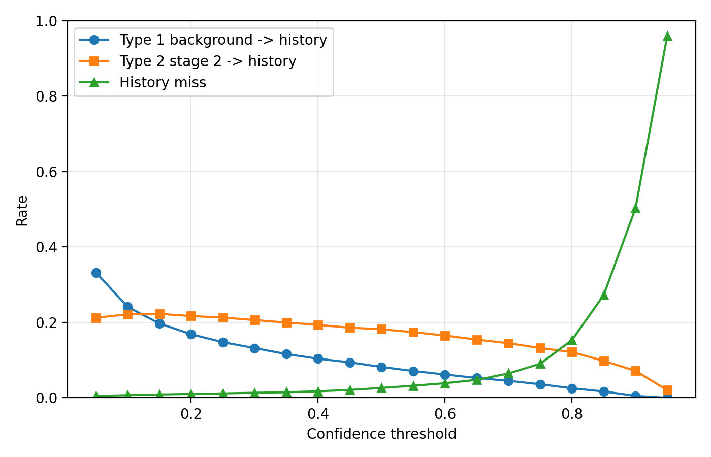


两阶段没有第三阶段及以后的类别，因此第三类误报率恒为 0。第二类误报率在 conf 0.10–0.25 附近达到约 21%–22%，随后缓慢下降；即使 conf ≥ 0.90，仍有 7.2% 的上报框把未见过的 stage-2 目标报成历史类（137/1912）。第一类误报率随阈值上升快速下降（33.3% → 0.5%）。历史类漏检率在 conf 0.05–0.50 仅为 0.5%–2.6%，说明教师对已见过的历史类物体在增量训练集上仍保持很高召回；conf 0.90 时升至 50.2%（conf 0.95 为 96.0%），主要因为上报框数量骤减。

**同分布 vs 分布域外（同一模型、同一指标）**

教师模型在“同分布测试集”（阶段一测试集）与“增量训练集”（阶段二训练集）上的**总误报率**对照（conf = 0.25）。总误报率 = 第一类 + 第二类（+ 第三类）之和；“未见类别→历史类”即第二类（匹配到第二阶段目标却报成历史类）。

| 评测集 | 图像 | 上报框 | 总误报率 | 每图误报框 | 背景→历史类 | 未见类别→历史类 |
|---|---:|---:|---:|---:|---:|---:|
| 阶段一测试集（同分布） | 2729 | 4637 | 19.4% | 0.33 | 852 (18.4%) | 48 (1.0%) |
| 阶段二训练集（分布域外） | 5238 | 5577 | 36.0% | 0.38 | 823 (14.8%) | 1187 (21.3%) |

同分布 → 域外：**总误报率 19.4% → 36.0%（+16.6 pt）**，其中背景→历史类 18.4% → 14.8%（−3.6 pt；绝对框数 852 → 823，每图 0.31 → 0.16），未见类别→历史类 1.0% → 21.3%（+20.3 pt；绝对框数 48 → 1187，每图 0.018 → 0.227）。即总误报的上升几乎全部来自“把未见过的类别报成历史类”，而纯背景误报反而下降；两者的每图误报框总数接近（0.33 → 0.38），说明变化在误报**构成**，不是单纯的“框变多”。

逐阈值原始计数与全部指标：[error_rates.csv](runs/yolo26m_VOC_10+10_pretrained-from-yolo26m-cls_naive/teacher_errors/task_2/error_rates.csv) · [summary.txt](runs/yolo26m_VOC_10+10_pretrained-from-yolo26m-cls_naive/teacher_errors/task_2/summary.txt)

### 3.3 两阶段：误报在训练后模型上的严重性（阶段一 / 阶段二 / 累积测试集）

四个模型（基础模型、naive、YOLO-LwF、Joint）在三个测试集上的逐项误报如下（conf = 0.25）。**总误报率**为各类误报占上报框总数的比例之和，后面各列只用于分解它上涨/下降的来源。

阶段一测试集：

| 方法 | 上报框 | 总误报率 | 背景→增量类 | 背景→历史类 | 历史类→增量类 | 增量类→历史类 | 历史类漏检率 |
|---|---:|---:|---:|---:|---:|---:|---:|
| 基础模型（stage-1） | 4637 | 19.4% | 0 (0.0%) | 852 (18.4%) | 0 (0.0%) | 48 (1.0%) | 18.9% |
| naive | 3507 | 41.1% | 837 (23.9%) | 0 (0.0%) | 604 (17.2%) | 0 (0.0%) | 85.8% |
| YOLO-LwF | 7431 | 25.1% | 831 (11.2%) | 739 (9.9%) | 271 (3.6%) | 27 (0.4%) | 18.5% |
| Joint | 7761 | 23.5% | 721 (9.3%) | 967 (12.5%) | 101 (1.3%) | 35 (0.5%) | 15.1% |

阶段二测试集：

| 方法 | 上报框 | 总误报率 | 背景→增量类 | 背景→历史类 | 历史类→增量类 | 增量类→历史类 | 历史类漏检率 |
|---|---:|---:|---:|---:|---:|---:|---:|
| 基础模型（stage-1） | 2899 | 52.2% | 0 (0.0%) | 890 (30.7%) | 0 (0.0%) | 622 (21.5%) | 23.0% |
| naive | 7834 | 19.1% | 1388 (17.7%) | 0 (0.0%) | 108 (1.4%) | 0 (0.0%) | 91.5% |
| YOLO-LwF | 9901 | 22.7% | 1428 (14.4%) | 634 (6.4%) | 74 (0.7%) | 108 (1.1%) | 19.3% |
| Joint | 10310 | 23.2% | 1519 (14.7%) | 726 (7.0%) | 57 (0.6%) | 93 (0.9%) | 18.1% |

累积测试集（阶段 1–2）：

| 方法 | 上报框 | 总误报率 | 背景→增量类 | 背景→历史类 | 历史类→增量类 | 增量类→历史类 | 历史类漏检率 |
|---|---:|---:|---:|---:|---:|---:|---:|
| 基础模型（stage-1） | 5709 | 34.5% | 0 (0.0%) | 1350 (23.6%) | 0 (0.0%) | 622 (10.9%) | 18.9% |
| naive | 8664 | 26.8% | 1722 (19.9%) | 0 (0.0%) | 604 (7.0%) | 0 (0.0%) | 85.8% |
| YOLO-LwF | 12924 | 24.2% | 1709 (13.2%) | 1034 (8.0%) | 271 (2.1%) | 108 (0.8%) | 18.5% |
| Joint | 13454 | 23.2% | 1669 (12.4%) | 1261 (9.4%) | 101 (0.8%) | 93 (0.7%) | 15.1% |

按总误报率看：阶段一测试集上 naive 41.1% > YOLO-LwF 25.1% > Joint 23.5%（基础模型 19.4%）；阶段二测试集上基础模型 52.2% 明显最高，三个训练后的模型降到 19.1%–23.2%；累积测试集上基础模型 34.5%、naive 26.8%、YOLO-LwF 24.2%、Joint 23.2%。

### 3.4 多阶段：教师模型在阶段二训练集上的误报

第二阶段训练集 2823 张；GT 8074 个（历史 315 / 第二阶段 4840 / 未来 2919）。

| Conf | 上报框 | 总误报率 | 第一类误报率 | 第二类误报率 | 第三类误报率 | 历史类漏检率 |
|---|---:|---:|---:|---:|---:|---:|
| 0.05 | 2100 | 84.4% | 46.7% | 33.8% | 3.9% | 0.3% |
| 0.1 | 1608 | 79.9% | 38.2% | 37.4% | 4.3% | 0.3% |
| 0.25 | 1107 | 71.7% | 28.3% | 38.9% | 4.5% | 0.6% |
| 0.5 | 782 | 60.7% | 19.7% | 37.1% | 4.0% | 1.9% |
| 0.7 | 570 | 48.6% | 12.6% | 31.6% | 4.4% | 6.0% |
| 0.9 | 120 | 22.5% | 1.7% | 17.5% | 3.3% | 70.5% |


多阶段的第二类误报率在 conf 0.25 为 38.9%，在 conf 0.30–0.45 维持在约 38%–39%，conf 0.90 仍有 17.5%；第三类误报率在 conf 0.05–0.90 稳定在 3.3%–4.5%。也就是说，高置信度上报框中有相当比例来自教师完全未见过、且属于不同后续阶段的类别。相比两阶段，多阶段的第二类误报率约高一倍，第三类误报持续存在，原因与其 stage-2 训练集只有 3.9% 的历史类 GT 直接对应。历史类漏检率在 conf 0.05–0.50 为 0.3%–1.9%，conf 0.70 为 6.0%，conf 0.90 升至 70.5%，趋势与两阶段一致。

**同分布 vs 分布域外（同一模型、同一指标）**

教师模型（第一阶段 5 类）在阶段一测试集与阶段二训练集上的总误报率对照（conf = 0.25）；多阶段另有“未来阶段→历史类”（第三类）。

| 评测集 | 图像 | 上报框 | 总误报率 | 每图误报框 | 背景→历史类 | 未见类别→历史类 | 未来阶段→历史类 |
|---|---:|---:|---:|---:|---:|---:|---:|
| 阶段一测试集（同分布） | 1101 | 1737 | 17.5% | 0.28 | 295 (17.0%) | 9 (0.5%) | 7 (0.40%) |
| 阶段二训练集（分布域外） | 2823 | 1107 | 71.7% | 0.28 | 313 (28.3%) | 431 (38.9%) | 50 (4.5%) |

同分布 → 域外：**总误报率 17.5% → 71.7%（+54.2 pt）**，其中背景→历史类 17.0% → 28.3%（绝对框数 295 → 313，每图 0.27 → 0.11），未见类别→历史类 0.5% → 38.9%（绝对框数 9 → 431，每图 0.008 → 0.153），未来阶段→历史类 0.40% → 4.5%。同样地，上升主要来自“未见类别被报成历史类”，每图总误报框数几乎不变（0.28 → 0.28）。

逐阈值原始计数与全部指标：[error_rates.csv](runs/yolo26m_VOC_5+5+5+5_pretrained-from-yolo26m-cls_naive/teacher_errors/task_2/error_rates.csv) · [summary.txt](runs/yolo26m_VOC_5+5+5+5_pretrained-from-yolo26m-cls_naive/teacher_errors/task_2/summary.txt)

### 3.5 多阶段：误报在训练后模型上的严重性（阶段一 / 阶段二 / 累积测试集）

四个模型在三个测试集上的逐项误报如下（conf = 0.25）；多阶段另有“未来阶段→历史类”。总误报率同样为各类误报之和。

阶段一测试集：

| 方法 | 上报框 | 总误报率 | 背景→增量类 | 背景→历史类 | 历史类→增量类 | 增量类→历史类 | 未来阶段→历史类 | 历史类漏检率 |
|---|---:|---:|---:|---:|---:|---:|---:|---:|
| 基础模型（stage-1） | 1737 | 17.5% | 0 (0.0%) | 295 (17.0%) | 0 (0.0%) | 2 (0.1%) | 7 (0.40%) | 20.8% |
| naive | 486 | 88.3% | 241 (49.6%) | 0 (0.0%) | 160 (32.9%) | 0 (0.0%) | 0 (0.00%) | 91.2% |
| YOLO-LwF | 1698 | 25.8% | 173 (10.2%) | 172 (10.1%) | 70 (4.1%) | 0 (0.0%) | 3 (0.18%) | 31.3% |
| Joint | 2980 | 21.0% | 58 (1.9%) | 316 (10.6%) | 21 (0.7%) | 0 (0.0%) | 7 (0.23%) | 19.3% |

阶段二测试集：

| 方法 | 上报框 | 总误报率 | 背景→增量类 | 背景→历史类 | 历史类→增量类 | 增量类→历史类 | 未来阶段→历史类 | 历史类漏检率 |
|---|---:|---:|---:|---:|---:|---:|---:|---:|
| 基础模型（stage-1） | 583 | 88.7% | 0 (0.0%) | 230 (39.5%) | 0 (0.0%) | 264 (45.3%) | 23 (3.95%) | 32.0% |
| naive | 3003 | 22.8% | 641 (21.3%) | 0 (0.0%) | 2 (0.1%) | 0 (0.0%) | 0 (0.00%) | 98.0% |
| YOLO-LwF | 3043 | 22.4% | 544 (17.9%) | 64 (2.1%) | 0 (0.0%) | 11 (0.4%) | 12 (0.39%) | 34.0% |
| Joint | 5063 | 25.3% | 585 (11.6%) | 52 (1.0%) | 1 (0.0%) | 5 (0.1%) | 1 (0.02%) | 35.0% |

累积测试集（阶段 1–2）：

| 方法 | 上报框 | 总误报率 | 背景→增量类 | 背景→历史类 | 历史类→增量类 | 增量类→历史类 | 未来阶段→历史类 | 历史类漏检率 |
|---|---:|---:|---:|---:|---:|---:|---:|---:|
| 基础模型（stage-1） | 2237 | 35.9% | 0 (0.0%) | 511 (22.8%) | 0 (0.0%) | 264 (11.8%) | 29 (1.30%) | 20.8% |
| naive | 3390 | 31.6% | 844 (24.9%) | 0 (0.0%) | 160 (4.7%) | 0 (0.0%) | 0 (0.00%) | 91.2% |
| YOLO-LwF | 4570 | 23.5% | 684 (15.0%) | 227 (5.0%) | 70 (1.5%) | 11 (0.2%) | 15 (0.33%) | 31.3% |
| Joint | 7761 | 23.6% | 613 (7.9%) | 354 (4.6%) | 21 (0.3%) | 5 (0.1%) | 7 (0.09%) | 19.3% |

按总误报率看：阶段一测试集上 naive 88.3% ≫ YOLO-LwF 25.8% > Joint 21.0%（基础模型 17.5%）；阶段二测试集上基础模型 88.7% 最高，训练后模型在 21%–23%；累积测试集上基础模型 35.9%，训练后模型 20%–22%。

### 3.6 典型错误可视化样例

样例在 conf ≥ 0.25 下按错误类型挑选：第一、二、三类取该类型中置信度最高的上报框（每张图至多一个），其中第一类样例额外要求上报框与任何 GT 都没有交集，以便展示纯背景误报；漏检取漏检历史类 GT 数最多的图像。灰框为 GT；蓝框为第一类误报，红框为第二类误报，品红框为第三类误报，绿框为匹配到历史类 GT 的上报框。逐图清单见各协议的 `examples/examples.csv`。

**两阶段 · 第一类误报（背景→历史类）**


三个样例分别为 `chair 0.92`（泳池边椅子）、`cow 0.90`（田间牛群）、`bird 0.90`（墙面装饰），均与完整标注空间中的任何 GT 都没有交集。需要说明：VOC 标注未覆盖的物体（如未被标注的椅子、牛）在统计上同样属于“完整类别空间下的背景”，第一类误报的视觉样例因此会包含这类漏标物体。

单张样例：[01](docs/images/motivation/two_stage_type1_01.png) · [02](docs/images/motivation/two_stage_type1_02.png) · [03](docs/images/motivation/two_stage_type1_03.png)

**两阶段 · 第二类误报（第二阶段→历史类）**


三个样例为 `chair 0.95`（GT 为 sofa）、`cat 0.95`（GT 为 dog）、`cat 0.95`（GT 为 dog）。教师对从未作为正类训练的沙发、狗给出高置信度的历史类框，而对应的 stage-2 GT 被完全错误命名。

单张样例：[01](docs/images/motivation/two_stage_type2_01.png) · [02](docs/images/motivation/two_stage_type2_02.png) · [03](docs/images/motivation/two_stage_type2_03.png)

**两阶段 · 漏检**


三个样例分别有 3、2、2 个漏检的历史类 GT（car x3；car x2；bottle x2），图中灰框为全部 GT，底部文字给出漏检的历史类构成；可见教师在这几张图上漏掉了 car、bottle 等历史类物体，同时仍能检出部分历史类物体（绿框）。

单张样例：[01](docs/images/motivation/two_stage_miss_01.png) · [02](docs/images/motivation/two_stage_miss_02.png) · [03](docs/images/motivation/two_stage_miss_03.png)

**多阶段 · 第一类误报（背景→历史类）**


三个样例为 `bottle 0.91`（厨房窗台瓶子）、`bottle 0.90`（路牌）、`bird 0.90`（田间鸡）。其中路牌样例是典型的纯背景误报，另外两个对应 VOC 未标注物体。

单张样例：[01](docs/images/motivation/four_stage_type1_01.png) · [02](docs/images/motivation/four_stage_type1_02.png) · [03](docs/images/motivation/four_stage_type1_03.png)

**多阶段 · 第二类误报（第二阶段→历史类）**

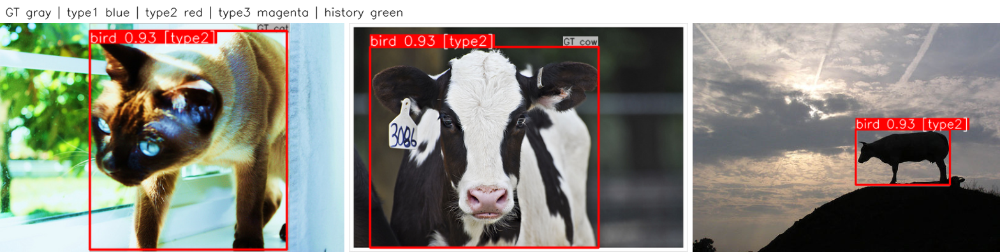

三个样例为 `bird 0.93`（GT 为 cat）、`bird 0.93`（GT 为 cow）、`bird 0.93`（GT 为 cow，剪影）。教师把 stage-2 的猫、牛稳定地报成历史类 bird。

单张样例：[01](docs/images/motivation/four_stage_type2_01.png) · [02](docs/images/motivation/four_stage_type2_02.png) · [03](docs/images/motivation/four_stage_type2_03.png)

**多阶段 · 第三类误报（第三阶段及以后→历史类）**

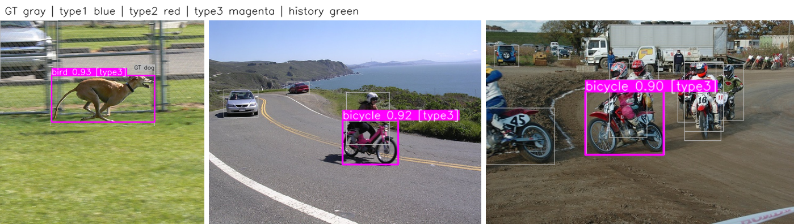

三个样例为 `bird 0.93`（GT 为 dog，stage-3）、`bicycle 0.92`（GT 为 motorbike，stage-3）、`bicycle 0.90`（GT 为 motorbike，stage-3）。教师把后续阶段的狗、摩托车高置信度地报成历史类 bird/bicycle；这类错误在多阶段增量中会持续污染后续阶段的蒸馏信号。

单张样例：[01](docs/images/motivation/four_stage_type3_01.png) · [02](docs/images/motivation/four_stage_type3_02.png) · [03](docs/images/motivation/four_stage_type3_03.png)

**多阶段 · 漏检**


conf 0.25 下多阶段教师只漏掉 2 个历史类 GT，分布在两个样例中（bottle x1；bottle x1）。图中灰框为全部 GT，底部文字给出漏检的历史类构成；可见历史类漏检在此阈值下已经很少。

单张样例：[01](docs/images/motivation/four_stage_miss_01.png) · [02](docs/images/motivation/four_stage_miss_02.png)

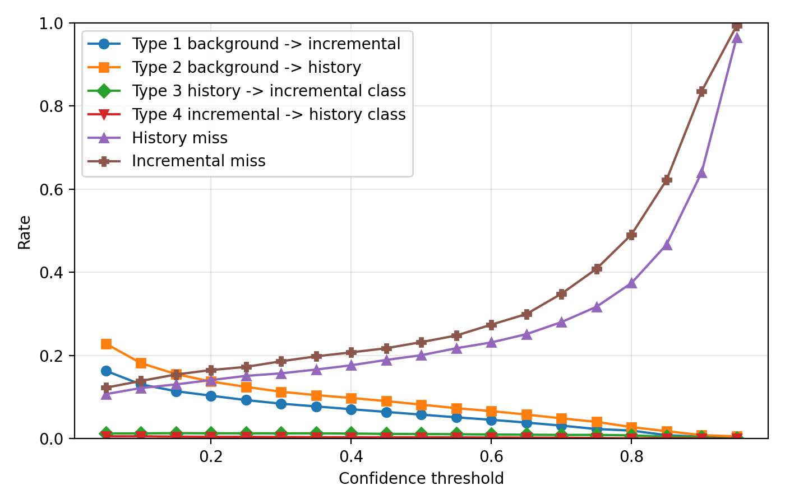

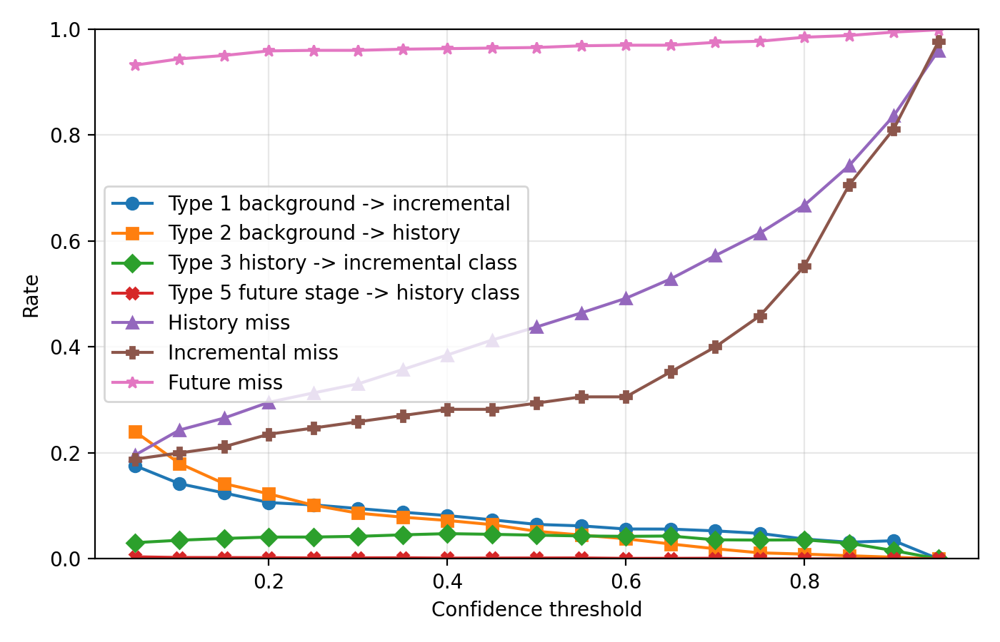

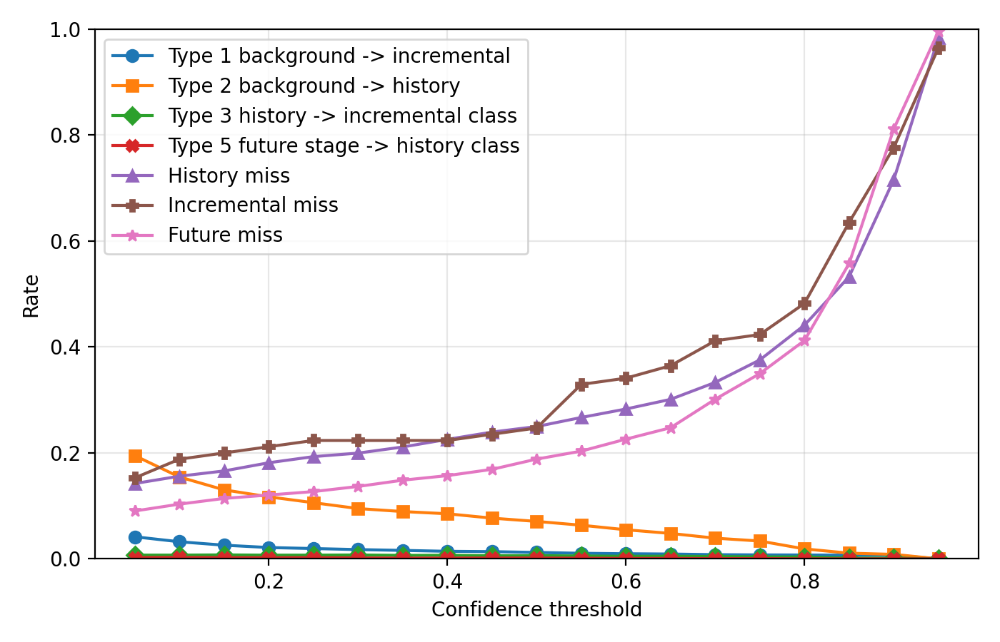

第三类误报的典型样例：LwF 上置信度最高的三个样例均为 `bicycle 0.76 / 0.73 / 0.67`（GT 为 stage-3 的 motorbike），Joint 为 `boat 0.51`（GT 为 stage-3 的 diningtable）；背景→历史类的典型样例（LwF，阶段一测试集）为 `boat 0.85`、`bottle 0.83`、`bottle 0.79`，均与完整标注空间中任何 GT 的 IoU ≤ 0.5。

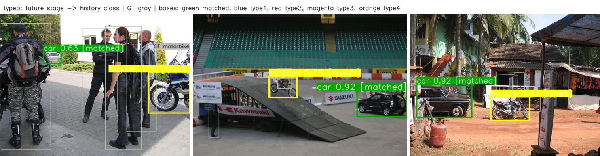

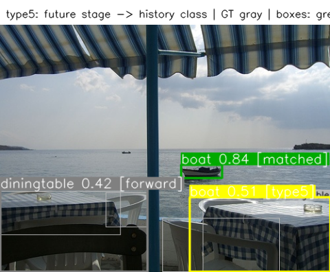

### 3.7 结果分析

**普遍性（教师本身的误报）**

- **总误报率随数据分布外移而显著上升，且上升部分几乎全部是“未见类别→历史类”。** 同一教师、同一指标：10+10 由同分布测试集 19.4% 升到增量训练集 36.0%（+16.6 pt，每图误报框 0.33 → 0.38），分解为背景→历史类 18.4% → 14.8%（每图 0.31 → 0.16）与未见类别→历史类 1.0% → 21.3%（每图 0.018 → 0.227）；5+5+5+5 由 17.5% 升到 71.7%（+54.2 pt，每图 0.28 → 0.28），分解为背景→历史类 17.0% → 28.3%、未见类别→历史类 0.5% → 38.9%、未来阶段→历史类 0.40% → 4.5%。也就是说，域外泛化抬高的是**误报在输出中的占比与构成**，而不是“背景误报变多”。
- 高置信度误报是稳定的：两阶段在 conf ≥ 0.50 时仍有 18.2% 的上报框把 stage-2 目标报成历史类，conf ≥ 0.90 时为 7.2%；多阶段对应为 37.1% 和 17.5%，另有 4.0% 和 3.3% 的第三类误报。误报率并非只由低置信度长尾贡献。
- 多阶段的教师错误明显更强：其 stage-2 训练集只有 315 个历史类 GT（3.9%），教师面对的对象主要来自未见过类别；两阶段该比例为 23.4%。这与多阶段更高的第二类误报率和持续存在的第三类误报一致。
- 第一类误报随阈值上升而快速衰减（两阶段 33.3%→0.5%，多阶段 46.7%→1.7%），说明纯背景误报主要来自低置信度长尾；高置信度误报主要是“把未见过的物体报成历史类”。
- 历史类漏检率在常规阈值下很低（conf 0.05–0.50：两阶段 0.5%–2.6%，多阶段 0.3%–1.9%；conf 0.70：6.5% / 6.0%），说明教师在本阶段数据上对已见过的历史类物体仍保持较高召回；conf 0.90 时升至 50.2% / 70.5%，主要是上报框数量骤减所致。因此教师的高置信度错误主要表现为“把未见过类别报成历史类”，而不是“漏掉历史类”。
- 第一类误报的可视化包含 VOC 漏标物体，这是“以完整标注空间定义背景”的必然结果；统计口径本身严格按 GT 判定，未引入额外过滤。

**严重性（训练后模型上的延续与对照）**

- **按总误报率看**：10+10 三个测试集上依次为 基础模型 19.4% / 52.2% / 34.5%、naive 41.1% / 19.1% / 26.8%、YOLO-LwF 25.1% / 22.7% / 24.2%、Joint 23.5% / 23.2% / 23.2%；5+5+5+5 上为 基础模型 17.5% / 88.7% / 35.9%、naive 88.3% / 22.8% / 31.6%、YOLO-LwF 25.8% / 22.4% / 23.5%、Joint 21.0% / 25.3% / 23.6%。两点值得注意：①基础模型在域外测试集（阶段二测试集）上总误报率最高（52.2% / 88.7%），训练后的模型把它压到 19%–25%；②在同分布测试集上 naive 反而最高（41.1% / 88.3%），因为旧类整体失忆后它把旧类目标记成新类或干脆乱报，说明“总误报率”必须与正确率一起看。
- **基础模型给出的是“增量前”的参照，并且印证了教师的不可靠性。** 它只有历史类通道，故“背景→增量类”“历史类→增量类”按定义为 0；它的“背景→历史类”是所有方法里最高的（10+10：18.4% / 30.7% / 23.6%，5+5+5+5：17.0% / 39.5% / 22.8%），即在未见分布上会把大量背景判成历史类。
- **基础模型的“增量类→历史类”与“未来阶段→历史类”就是实验组 2 的第二、三类教师误报，可交叉验证。** 阶段二测试集：10+10 为 21.5%，5+5+5+5 为 45.3% 与 3.95%；与 §3.2、§3.4 在阶段二**训练集**上测得的 21.3%、38.9%/4.5% 量级一致（本表为测试集，数值略高）。这说明“教师把新未见过类别挤进历史类”是稳定现象。
- **naive 的 0 仍是退化值**：旧类通道整体塌缩（历史类漏检 85.8%–98.0%，旧类 mAP = 0.000），不再输出历史类，因此“背景→历史类”“未来阶段→历史类”恒为 0。
- **增量训练相对基础模型主要降低“背景→历史类”**：YOLO-LwF 与 Joint 从基础模型的 18%–31%（10+10）降到 6%–12%，即增量阶段压低了旧类在背景上的过度响应；代价是出现“背景→增量类”“历史类→增量类”这两类新类误报（基础模型按定义没有）。
- **需要持续关注的第一类（背景→增量类）并未被“找回旧类”解决**：10+10 阶段一测试集 naive 837 框、YOLO-LwF 831 框、Joint 721 框；5+5+5+5 阶段一 241 / 173 / 58 框。只有联合训练显著下降，抗遗忘本身几乎没有改动绝对量（基础模型对该指标无参考值）。
- **第三类（未来阶段→历史类）与旧类召回**：基础模型 0.40% / 3.95% / 1.30% 与 20.8%–32.0% 漏检，YOLO-LwF 0.18% / 0.39% / 0.33% 与 31.3%–34.0%，Joint 最低（0.02%–0.23%）；三者旧类召回接近，说明增量训练的主要损失在旧类的**标记质量**（历史类→增量类、背景→历史类）而非“能否检出”。
- conf = 0.50 时同向：10+10 的“背景→历史类”基础模型 474/474/739 框、YOLO-LwF 350/287/484 框、Joint 529/378/685 框（阶段一/阶段二/累积）；5+5+5+5 基础模型 183/115/289 框、YOLO-LwF 64/22/81 框、Joint 175/23/190 框；naive 恒为 0。
- 5+5+5+5 的阶段二测试集只有 100 个历史类 GT（该阶段图像几乎不含第一阶段类别），该行波动大，趋势应以阶段一测试集与累积测试集为主。


## 4. 实验组 3：增量模型在历史任务上的高置信度错误（10+10）

对应 ICLR 审稿意见中 motivation 的实验组 3。两阶段协议 `VOC_10+10`，模型 yolo26m、预训练权重 `yolo26m-cls.pt`，100 epoch，超参与实验组 1/2 完全一致（见 §1.2）。对比 naive 微调与 YOLO-LwF 自蒸馏，并补上 Joint（单阶段联合训练）作为上界参考；**YOLO-LwF 在本实验中不使用 replay**（教师为第一阶段模型，分类蒸馏权重 4000、回归蒸馏权重 500、回归 CE 温度 2.0、WCE 与 Cls-IoU 加权开启、旧类通道掩码开启）。第一阶段不做蒸馏，因此两个方法的 stage-1 使用同一份 checkpoint。

### 4.1 主结果（任务未知评测）

评测方式为任务未知（task-unknown）：模型始终使用其完整类别空间的检测头推理，只对当前测试集有标注的类别计算 AP 并聚合平均，不把其它类别的 AP 计入。

| method&stage | test-1 | test-2 | seen-2-task-1 | seen-2-task-2 |
|---|---:|---:|---:|---:|
| naive-stage-1 | 82.5 | — | 76.8 | — |
| naive-stage-2 | 0.0 | 81.0 | 0.0 | 76.8 |
| YOLO-LwF-stage-1 | 82.5 | — | 76.8 | — |
| YOLO-LwF-stage-2 | 78.8 | 78.4 | 76.7 | 76.0 |
| Joint（单阶段） | 83.1 | 81.6 | 81.7 | 80.7 |

上表为 mAP50（%）；同一组数字的 mAP50-95 见下表。

| method&stage | test-1 | test-2 | seen-2-task-1 | seen-2-task-2 |
|---|---:|---:|---:|---:|
| naive-stage-1 | 60.4 | — | 56.6 | — |
| naive-stage-2 | 0.0 | 59.4 | 0.0 | 56.5 |
| YOLO-LwF-stage-1 | 60.4 | — | 56.6 | — |
| YOLO-LwF-stage-2 | 57.6 | 56.9 | 56.3 | 55.3 |
| Joint（单阶段） | 61.5 | 60.1 | 60.6 | 59.4 |

列定义：

- `test-1`：第一个任务测试集上旧类（stage-1 的 10 类）的 AP 平均；stage-2 行即“旧类是否被保住”。
- `test-2`：第二个任务测试集上新类（stage-2 的 10 类）的 AP 平均。
- `seen-2-task-1` / `seen-2-task-2`：前两阶段累积测试集（`task_1-2_cls_20`）上分别对旧类、新类 AP 的聚合平均。
- “—”表示该阶段模型不含对应类别通道，评测脚本输出空表；不要读作 0。
- `Joint（单阶段）`：全 20 类联合训练一次（同一模型也用于多阶段协议），作为上界参考；其 `test-1` / `test-2` 即旧类 / 新类精度，`seen-2-*` 为累积测试集上按组聚合。

数据来源：`evaluation_results/model_{1,2}_eval_task_{1,2}_stage_mAP.csv` 与 `model_{1,2}_eval_cumulative_2_stage_mAP.csv`（`scripts/eval.sh` 自动生成的按阶段聚合表）。

### 4.2 错误率（重点：第一、三类误报率）

模型在**历史任务（stage-1）测试集**的 2729 张图像上推理，GT 使用完整 20 类标注（旧类目标 4585 个、增量类目标 2518 个）。每个 GT 目标按其 IoU 最大的上报框归类，conf = 0.25（Ultralytics 默认推理阈值）：

| 对象级统计（conf 0.25） | naive | YOLO-LwF |
|---|---:|---:|
| 旧类目标 → 正确历史类 | 0.0% (0) | 75.7% (3469) |
| 旧类目标 → 增量类（第三类误报） | 14.2% (652) | 5.9% (269) |
| 旧类目标漏检（第一类漏检） | 85.8% (3933) | 18.5% (847) |
| 增量类目标 → 正确增量类 | 80.4% | 79.2% |
| 增量类目标 → 历史类（第四类误报） | 0.0% | 1.1% |
| 增量类目标漏检（第二类漏检） | 19.6% | 19.7% |
| 背景 → 增量类（第一类误报，框数） | 837 | 831 |
| 背景 → 历史类（第二类误报，框数） | 0 | 739 |

conf = 0.50 时同向：第三类误报 10.8% → 4.8%，旧类漏检 89.2% → 25.9%，第一类误报框数 472 → 416（0.173 → 0.152 个/图）。

口径提醒：`error_rates.csv` 中的误报率以上报框总数为分母。两个方法的上报框总数差异很大（conf 0.25：3507 vs 7431），因此**必须以绝对框数或对象级比例比较**；按比例读会把第一类误报误判为“减半”。

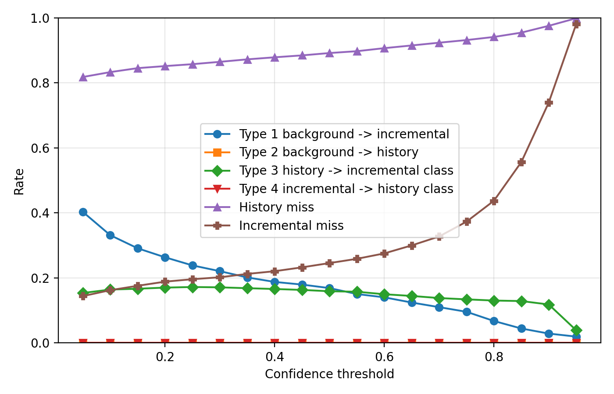

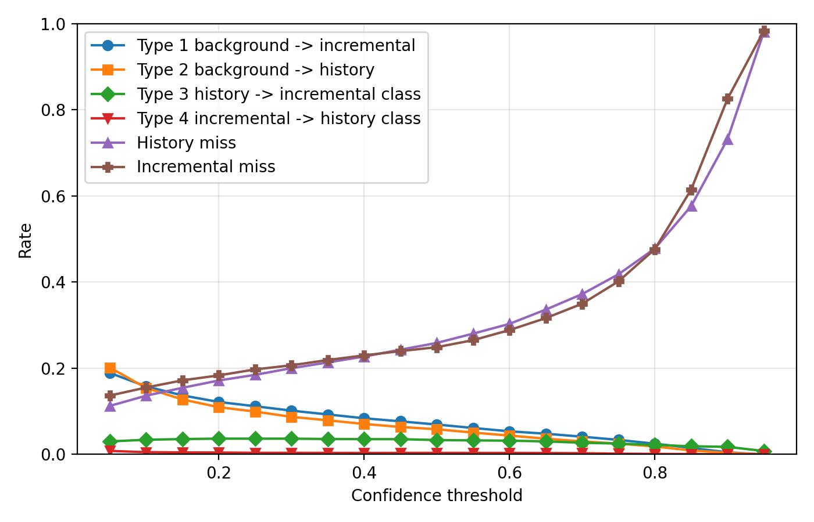

### 4.3 典型错误可视化样例

样例在 conf ≥ 0.25 下按错误类型挑选，取该类型中置信度最高的上报框（每张图至多一个）。灰框为 GT，蓝框为第一类误报，品红框为第三类误报，绿框为匹配到历史类 GT 的上报框。逐图清单见各 run 的 `examples/examples.csv`。

**naive · 第一类误报（背景→增量类）**

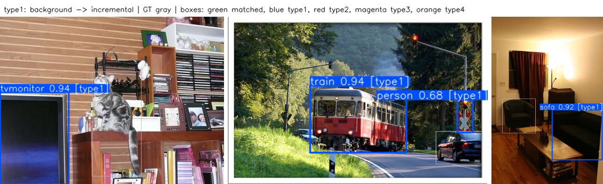

三个样例为 `tvmonitor 0.94`、`train 0.94`（同图另有一个 `person 0.68`）、`sofa 0.92`，在完整标注空间中均无 IoU > 0.5 的 GT。与实验组 2 的同类样例一致，这类样例会包含 VOC 漏标物体，统计口径本身严格按 GT 判定。

**YOLO-LwF · 第一类误报（背景→增量类）**

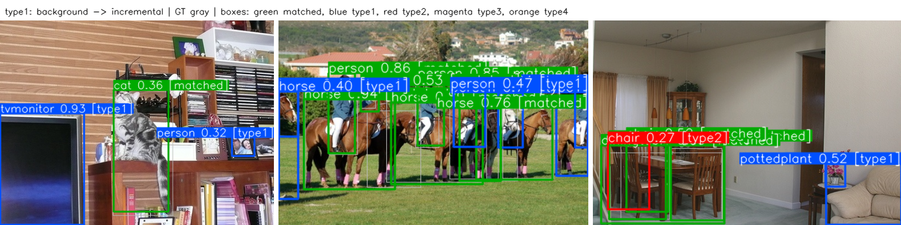

三个样例为 `tvmonitor 0.93`、`horse 0.93`、`sofa 0.91`，与 naive 的最高置信度样例几乎同源（同一张图的 tvmonitor、sofa 场景）。这与“第一类误报的绝对数量未随抗遗忘方法下降”在定性上吻合。

**naive · 第三类误报（历史类→增量类）**

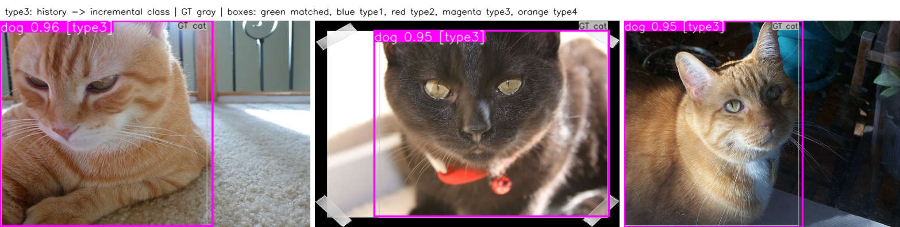

三个样例均为 `dog 0.96/0.95/0.95`（GT 为 cat）：旧类 cat 被稳定地高置信度改名成增量类 dog，对应旧类 AP 归零。

**YOLO-LwF · 第三类误报（历史类→增量类）**

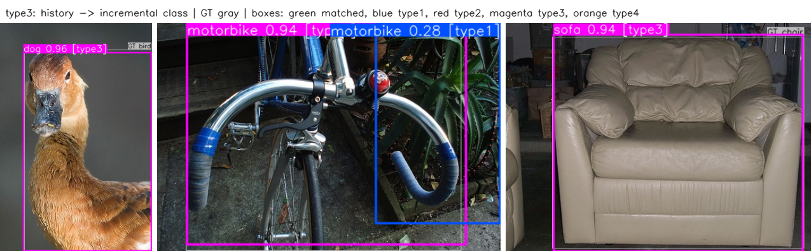

三个样例为 `dog 0.96`（GT 为 bird）、`motorbike 0.94`（GT 为 bicycle）、`sofa 0.94`（GT 为 chair）：同类混淆仍然存在且置信度很高，但发生频率降到 naive 的约 2.4 分之一。

### 4.4 结果分析

- **第三类误报被显著缓解但未消除。** 对象级由 14.2% 降到 5.9%（652 → 269 个旧类目标），conf 0.50 时 10.8% → 4.8%。剩余部分与“增量训练从未见过历史任务样本分布的负样本”直接相关，单靠输出自蒸馏无法消除，需要原型/回放类手段。
- **第一类误报基本不受抗遗忘影响。** 绝对框数 837 → 831（0.307 → 0.305 个/图），conf 0.50 时 472 → 416（−12%）；按比例看从 23.9% 降到 11.2%，但这是分母从 3507 涨到 7431 造成的。这说明恢复旧类响应并不会抑制模型在历史背景上的新类幻觉，与实验计划中“第一类误报无法被经典 GT 匹配过滤、也难以由抗遗忘方法解决”的判断一致。
- **“可解”指标按预期改善。** 旧类漏检 85.8% → 18.5%，旧类 AP 0.0 → 78.8，旧类遗忘量（相对 stage-1 的 mAP50）由 −82.5 降到 −3.7；同时增量类指标几乎不动（新类 mAP50 −2.6、增量类漏检 19.6% → 19.7%、增量类正确率 80.4% → 79.2%），说明 LwF 没有牺牲可塑性。
- **与 Joint 上界的差距**：Joint 为 83.1 / 81.6 / 81.7 / 80.7（mAP50，依次 test-1 / test-2 / seen-2-task-1 / seen-2-task-2），YOLO-LwF 相对它的差距只有 4.3 / 3.2 / 5.0 / 4.7 点，而 naive 在旧类上差 81.7 点（mAP50-95 下对应 3.9 / 3.2 / 4.3 / 4.1 点 vs 60.6 点）。也就是说：**一个不含 replay 的自蒸馏方法，已经把“旧类不掉”做到接近联合训练上界，剩余的差距主要在新类可塑性与两类背景幻觉上。**
- **累积口径下的组间均衡是关键证据。** stage-2 的 YOLO-LwF 在累积测试集上 old/new = 76.7 / 76.0；naive 为 0.0 / 76.8。第一类与第三类误报在后续阶段会持续把旧类目标记到新类头上，累积口径直接体现为旧类 AP 缺失。
- **stage-1 行的 `seen-2-task-1` 低于 `test-1`（76.8 vs 82.5）是任务未知评测的必然结果**：累积测试集包含大量 stage-2 图像，stage-1 模型没有这些类别的通道，这些目标对旧类而言成为背景误报，从而拉低旧类 AP。这也说明“累积测试集 + 任务未知”是最严格的旧类保持度量。
- **本实验组只覆盖两阶段。** 多阶段的第三类误报会向后续每个阶段累积，需在 `VOC_5+5+5+5` 上重复本实验组才能量化其放大效应。

## 5. 整理

本节汇总时间线、结论摘要、关键数字与产物索引；正文的数据与表格分布在前四节（按修改大纲的实验顺序）。

### 5.1 时间线

| 日期 | 内容 | 主要产物 |
|---|---|---|
| 11-11 | 阶段数据集构建；阶段类别分布与样本交集（实验组 1）；教师模型高置信度错误（实验组 2，两阶段 + 多阶段） | `stage_stats/`、`teacher_errors/` |
| 11-12 | 10+10 增量模型错误率（实验组 3，naive vs YOLO-LwF）；Joint 训练（20 类联合，二协议共用）；增量模型在各测试集的历史类误报（§3.3、§3.5） | `incremental_errors/`、`history_errors*/` |
| 11-12 → 11-13 | 5+5+5+5 四阶段完整训练（naive / YOLO-LwF，stage-3/4 补齐）与四阶段评测 | `task-3/{task-4}/best.pt`、`evaluation_results/` |

### 5.2 结论摘要

**实验组 1–2**

1. 阶段数据集按“吸收所有包含当前阶段训练类别的图像”构建，因此不同阶段的图像存在大量重叠（两阶段 stage-1/stage-2 共享 1844 张训练图像；多阶段 stage-2 与 stage-3 共享 1014 张）。图像重叠并不等于类别重叠：训练标注仍按阶段类别过滤。
2. 历史阶段训练图像中实际包含大量后续类别目标，但这些标注在训练时被过滤。两阶段 stage-1 图像中含 4424 个 stage-2 目标（其中 person 3084 个）；多阶段 stage-1 图像中含 2282 个后续阶段目标。这构成“历史任务阶段缺乏未来类别”的直接来源。
3. 增量阶段训练集几乎不含历史类别：多阶段 stage-2 的 8074 个 GT 中仅 315 个（3.9%）属于历史类；两阶段 stage-2 为 3587/15294（23.4%）。这构成“增量任务阶段缺乏历史类别”的直接来源。
4. 教师模型在增量阶段训练集上产生高置信度的历史类误报。conf ≥ 0.25 时，两阶段有 21.3% 的上报框把 stage-2 目标报成历史类；多阶段有 38.9% 把 stage-2 目标、4.5% 把 stage-3/4 目标报成历史类。conf ≥ 0.9 时，两阶段的第二类误报率仍为 7.2%，多阶段的第二类与第三类误报率合计仍为 20.8%。
5. 多阶段情形的教师错误显著强于两阶段：其 stage-2 训练集只有 3.9% 的历史类 GT，教师面对的 GT 有 96.1% 来自未见过类别。

**实验组 3**

1. 旧类精度：naive stage-2 在第一个任务测试集上的旧类 AP 归零（mAP50 82.5 → 0.0），YOLO-LwF stage-2 为 78.8（相对同方法 stage-1 只掉 3.7）；在累积测试集上旧类 AP 由 0.0 提升到 76.7，与同方法 stage-1 的 76.8 基本持平。
2. 新类代价有限：第二个任务测试集新类 mAP50 由 81.0 降到 78.4（−2.6），累积测试集新类由 76.8 降到 76.0（−0.8）。
3. 组间均衡：YOLO-LwF stage-2 在累积测试集上 old/new = 76.7 / 76.0（差 0.7），naive 为 0.0 / 76.8（差 76.8）。第一、三类误报对后续阶段的拖累在此处表现为“旧类 AP 整体消失”。
4. 重点误报（第一、三类）与“可解”误报的行为分离：YOLO-LwF 把旧类目标被判为增量类（第三类）从 14.2% 降到 5.9%（对象级），把旧类漏检从 85.8% 降到 18.5%；但**背景被判为增量类（第一类）的绝对数量几乎不变（837 → 831 个框，0.307 → 0.305 个/图）**，其“误报率”减半仅因为上报框总数翻倍（3507 → 7431）。这与“第一类误报无法被抗遗忘方法解决”的判断一致。
5. naive 的第二、四类误报恒为 0 并非鲁棒性证据：其旧类通道整体塌缩（旧类 AP = 0.0、class-agnostic 旧类召回 0.175），模型根本不再输出旧类。YOLO-LwF 出现的第二类（739 个框）与第四类（1.1% 目标）是旧类通道恢复后的必然副产物，按新的指标口径属于可由抗遗忘/增量方法继续处理的一类。

### 5.3 关键数字速览

| 观察 | 数值 |
|---|---|
| 教师/基础模型“同分布测试集 → 增量训练集”的总误报率 | 10+10：19.4% → **36.0%**；5+5+5+5：17.5% → **71.7%**（conf 0.25），上涨主要来自“未见类别→历史类”（每图框数 0.018 → 0.227、0.008 → 0.153） |
| 阶段一测试集上的总误报率（基础 / naive / YOLO-LwF / Joint） | 10+10：19.4% / 41.1% / 25.1% / 23.5%；5+5+5+5：17.5% / 88.3% / 25.8% / 21.0% |
| 基础模型/教师在阶段二训练集上的第二类误报（增量类→历史类） | 两阶段 21.3%、多阶段 38.9%（conf 0.25；阶段二测试集上为 21.5% / 45.3%，见 §3.3、§3.5） |
| 基础模型在未见分布上的背景→历史类 | 10+10 阶段二测试集 30.7%、5+5+5+5 阶段二测试集 39.5% |
| 增量模型旧类保持（10+10，旧类 mAP50） | naive **0.0** → YOLO-LwF **78.8**（Joint 上限 83.1） |
| 增量模型旧类保持（5+5+5+5 四阶段后，旧类 mAP50） | naive **0.0** → YOLO-LwF **52.6**（Joint 上限 82.4） |
| 累积全类精度（5+5+5+5，seen-4 mAP50） | naive 12.2 / YOLO-LwF 55.7 / Joint 81.2 |
| 背景→增量类（10+10 阶段一测试集，绝对框数） | 基础模型 0（无增量通道）/ naive 837 / YOLO-LwF 831 / Joint 721 |
| 背景→历史类（10+10 阶段一测试集） | 基础模型 18.4% / naive 0（通道塌缩）/ YOLO-LwF 9.9% / Joint 12.5% |
| 历史类→增量类（10+10 阶段一测试集） | 基础模型 0（无增量通道）/ naive 17.2% / YOLO-LwF 3.6% / Joint 1.3% |
| 历史类漏检率（10+10 阶段一测试集） | 基础模型 18.9% / naive 85.8% / YOLO-LwF 18.5% / Joint 15.1% |
| 未来阶段→历史类（5+5+5+5 阶段二测试集） | 基础模型 3.95% / naive 0 / YOLO-LwF 0.39% / Joint 0.02% |

### 5.4 产物与复现

#### 5.4.1 实验组 1 与 2

实现组件：

- `tools/stage_dataset_stats.py`：实验组 1 的类别目标数与阶段样本交集（`scripts/analyze.sh stage_stats`）。
- `tools/teacher_error_analysis.py`：实验组 2 的四类错误统计、曲线与典型样例（`scripts/analyze.sh teacher_errors`，`--vis_dir` / `--vis_conf` / `--vis_per_type`）。
- `tools/incremental_error_analysis.py`：增量模型（及 Joint 模型）在各测试集上的历史类错误统计，`--future_stages` 打开“未来阶段→历史类”分组（`scripts/analyze.sh incremental_errors`）。
- `scripts/voc/motivation/`：`common.sh` 集中协议与训练/分析参数，`create.sh` / `stats.sh` / `train.sh` / `teacher_errors.sh` / `pipeline.sh` 可单独运行或串联。

```bash
bash scripts/voc/motivation/create.sh        # 构建两个协议的阶段数据集
bash scripts/voc/motivation/stats.sh         # 实验组 1
PROTOCOL=two  EPOCHS=100 bash scripts/voc/motivation/train.sh
PROTOCOL=four EPOCHS=100 bash scripts/voc/motivation/train.sh
bash scripts/voc/motivation/teacher_errors.sh  # 实验组 2（含典型样例）
```

实验组 2 只依赖第一阶段教师，因此两个 run 目录最初只包含 `task-1`；两阶段协议的 `task-2` 已在实验组 3 中补齐（naive 与 YOLO-LwF 各一份），多阶段 run 仍只包含 `task-1`。如需补齐其它阶段的增量训练，使用 `START_TASK=2` 继续同一 run：

```bash
PROTOCOL=two  START_TASK=2 bash scripts/voc/motivation/train.sh
PROTOCOL=four START_TASK=2 bash scripts/voc/motivation/train.sh
```

结果目录：

- `runs/yolo26m_VOC_10+10_pretrained-from-yolo26m-cls_naive/`
- `runs/yolo26m_VOC_5+5+5+5_pretrained-from-yolo26m-cls_naive/`

每个协议下：`stage_stats/`（实验组 1 表格）、`task-1/best.pt`（教师）、`teacher_errors/task_2/error_rates.{csv,md,png}`、`teacher_errors/task_2/summary.txt`、`teacher_errors/task_2/examples/`（典型样例与 `examples.csv`）。

本报告引用的曲线与样例图已归档到 `docs/images/motivation/`。

#### 5.4.2 实验组 3（10+10）

```bash
# 训练（两阶段；naive 复用已有 task-1，LwF 复用同一 task-1 基座）
START_TASK=2 bash scripts/train.sh --tasks data/VOC_10+10/task_1_cls_10/dataset.yaml \
    data/VOC_10+10/task_2_cls_10/dataset.yaml --model yolo26m --method naive \
    --weights yolo26m-cls.pt --tag VOC_10+10 \
    --output runs/yolo26m_VOC_10+10_pretrained-from-yolo26m-cls_naive -- \
    --optimizer AdamW --lr0 0.001 --warmup_bias_lr 0.0 --mosaic 0.5 \
    --end2end False --agnostic_nms True --max_det 300
START_TASK=2 bash scripts/train.sh --tasks data/VOC_10+10/task_1_cls_10/dataset.yaml \
    data/VOC_10+10/task_2_cls_10/dataset.yaml --model yolo26m --method lwf \
    --weights yolo26m-cls.pt --tag VOC_10+10 \
    --output runs/yolo26m_VOC_10+10_pretrained-from-yolo26m-cls_lwf -- \
    --optimizer AdamW --lr0 0.001 --warmup_bias_lr 0.0 --mosaic 0.5 \
    --end2end False --agnostic_nms True --max_det 300

# 主结果表（任务未知、按阶段聚合）
bash scripts/eval.sh runs/yolo26m_VOC_10+10_pretrained-from-yolo26m-cls_naive \
    --tasks data/VOC_10+10/task_1_cls_10/dataset.yaml data/VOC_10+10/task_2_cls_10/dataset.yaml \
    --cumulative data/VOC_10+10/task_1_cls_10/dataset.yaml data/VOC_10+10/task_1-2_cls_20/dataset.yaml

# 错误率分析（含典型样例）
PROTOCOL=two bash scripts/voc/motivation/incremental_errors.sh
```

结果目录：

- `runs/yolo26m_VOC_10+10_pretrained-from-yolo26m-cls_naive/`：`task-2/best.pt`、`evaluation_results/`（含 `*_stage_mAP.csv`）、`incremental_errors/task-2-on-stage-1/`（`error_rates.{csv,md,png}`、`summary.txt`、`examples/`）。
- `runs/yolo26m_VOC_10+10_pretrained-from-yolo26m-cls_lwf/`：同上；`task-1/` 与 naive 共用同一 checkpoint。

本报告引用的曲线与样例图已归档到 `docs/images/motivation/two_stage_incremental_*.png`。

#### 5.4.3 多阶段（5+5+5+5）四阶段训练与评测

```bash
START_TASK=3 END_TASK=4 bash scripts/train.sh \
    --tasks data/VOC_5+5+5+5/task_1_cls_5/dataset.yaml data/VOC_5+5+5+5/task_2_cls_5/dataset.yaml \
            data/VOC_5+5+5+5/task_3_cls_5/dataset.yaml data/VOC_5+5+5+5/task_4_cls_5/dataset.yaml \
    --model yolo26m --method naive --weights yolo26m-cls.pt --tag VOC_5+5+5+5 \
    --output runs/yolo26m_VOC_5+5+5+5_pretrained-from-yolo26m-cls_naive -- \
    --optimizer AdamW --lr0 0.001 --warmup_bias_lr 0.0 --mosaic 0.5 \
    --end2end False --agnostic_nms True --max_det 300
# YOLO-LwF 同命令，--method lwf，输出到 ..._lwf（教师随阶段自动取上一阶段模型）

bash scripts/eval.sh --run runs/yolo26m_VOC_5+5+5+5_pretrained-from-yolo26m-cls_naive \
    --tasks data/VOC_5+5+5+5/task_{1,2,3,4}_cls_5/dataset.yaml \
    --cumulative data/VOC_5+5+5+5/task_1_cls_5/dataset.yaml \
                 data/VOC_5+5+5+5/task_1-2_cls_10/dataset.yaml \
                 data/VOC_5+5+5+5/task_1-3_cls_15/dataset.yaml \
                 data/VOC_5+5+5+5/task_1-4_cls_20/dataset.yaml
```

Joint 的四阶段评测在独立目录 `runs/yolo26m_VOC_joint4_pretrained-from-yolo26m-cls_naive/` 中进行（`task-1` 为指向 Joint 模型的软链接），以免覆盖该 run 下 10+10 协议已有的评测网格。

结果目录：`runs/yolo26m_VOC_5+5+5+5_pretrained-from-yolo26m-cls_{naive,lwf}/`（`task-{3,4}/best.pt`、`evaluation_results/*_stage_mAP.csv`）；历史类误报分析在各自 `history_errors/on-*/`。


# 2026-11-13 → 2026-11-14：原型可靠性感知蒸馏（prad + prd + ESPReg 二分实现）

按 `method_plan.md` 实现并跑通第一版方法：`prad`（原型可靠性感知 YOLO-LwF 蒸馏）+ `prd`（历史 patch 原型全类别回放蒸馏）+ `espreg`（新增 `raw/nt` 特征值权重与 `original/frobenius` 两种约束形式）。

## 1. 实现要点

| 组件 | 内容 |
|---|---|
| `ultralytics/engine/patch_proto.py` | 检测头输入 patch 半径推导、按位置取 patch、`RecordingDetectionLoss`（子类化官方 `v8DetectionLoss` 截获 TAL 分配结果，官方文件零改动）、固定共享 PCA `HeadPatchSubspace`（含无压缩回退）、多中心原型 `MultiCenterBank`（DP-Means + 对角协方差 + π + 采样 + 余弦匹配）、工件读写 |
| `ultralytics/engine/prad.py` | 前景/背景分离、原型可靠性门控 `g_k = sigmoid((r_k - τ_proto)/T_proto)`、`BKL`、前景回归蒸馏；`prad_split_normalize` 支持消融 |
| `ultralytics/engine/prd.py` | 每步采样 → PCA 重建 patch → 师生检测头前向（BN 临时 eval 后恢复）→ 全类别蒸馏（旧类软目标、新类概率 0）+ 回归 SmoothL1 |
| `ultralytics/engine/espreg.py` | `EWPRegLoss` → **`ESPRegLoss`**；`weight_mode ∈ {raw, nt}`、`form ∈ {original, frobenius}`、`scope ∈ {all, backbone}`。`original+nt` 与旧实现数值完全一致（回归检查：43.6557312012 vs 43.6557312012，相对差 0.0） |
| `tools/generate_patch_prototypes.py` | 工件生成（TAL 代表性位置 + GT 中心区域）与 §8.5/§14.1 报告：`--report_dims`（E_feat/E_cls/E_reg 按尺度/维度/类别）、`--report_similarity`、`--report_only`、`--split` |
| `tools/summarize_run.py` | 单个 run → 单 txt 汇总（协议、per-task/cumulative 矩阵、Old/New/All、分阶段 mAP、PCA 重建偏差、相似度、CSV 清单） |
| `scripts/offline_experiment.sh` | 离线一条命令：自动从 `VOC-YOLO` 切分数据 → 复用基础模型 → 训练增量阶段 → 评估 → PCA 报告 → txt 汇总；`--prepare-only` / `--train-base` / `--skip-eval` / `--skip-report` |
| `run_lwf_espreg_10+10.sh` | 离线单实验脚本（LwF + ESPReg，2×2 因子设计的补格） |
| `default.yaml` / 适配器 / `experiment.sh` | 新增 `patch_prototypes`、`prad_*`(10)、`prd_*`(5)、`espreg_weight_mode/espreg_form/espreg_scope`；`prad`/`prd` 组件；基础阶段工件可按需重建 |

## 2. 实验协议

- 数据集：VOC 10+10（CIL）；基础阶段 task-1 **复用** `runs/yolo26m_VOC_10+10_pretrained-from-yolo26m-cls_naive/task-1/best.pt`，只训练 task-2（`START_TASK=2`）。
- 训练：yolo26m（init `yolo26m-cls.pt`），100 epoch，batch 16，imgsz 640，AdamW / lr0 0.001 / lrf 0.01 / wd 0.0005 / warmup_bias_lr 0.0 / mosaic 0.5，`end2end False`。
- 方法超参（v2 = 主结果）：ESPReg `raw` 原始特征值 + `frobenius` 约束 + `scope=all` + λ_ESP=0.01；`λ_KD=30`、`λ_reg=1.5`、`λ_PRD=30`、`λ_PRD-reg=5`、`τ_F=0.5`、`τ_B=0.1`、`η_B=1`、`τ_proto=0.3`、`T_proto=0.1`、`prd_samples=64/尺度`、patch PCA d=128、patch 半径 r=2（5×5）。
- 评估：`scripts/eval.sh` 的 per-task + cumulative 序列，class-aware 与 class-agnostic 两种协议，指标 mAP50-95。

## 3. 主结果（VOC 10+10，最终模型）

class-aware：

| Method | T1 (Old) mAP50 | T2 (New) mAP50 | All mAP50 | T1 mAP50-95 | T2 mAP50-95 | All mAP50-95 |
|---|---|---|---|---|---|---|
| naive | 0.0 | 80.99 | 38.41 | 0.0 | 59.41 | 28.27 |
| YOLO-LwF | 78.79 | 78.41 | 76.34 | 57.56 | 56.89 | 55.82 |
| Joint（上界） | 84.67 | 82.98 | 82.44 | 62.55 | 61.03 | 60.89 |
| 本方法 v1（λ_KD=4, λ_ESP=0.03） | 55.32 | 79.50 | 62.19 | 35.21 | 56.70 | 42.54 |
| **本方法 v2（λ_KD=30, λ_ESP=0.01）** | **69.50** | **81.00** | **71.14** | **47.97** | **58.06** | **50.29** |
| 本方法 prad+prd（去掉 ESPReg） | 59.54 | 80.82 | 65.93 | 40.47 | 59.06 | 46.92 |

class-agnostic（object 协议，只看定位/objectness）：

| Method | T1 mAP50-95 | T2 mAP50-95 |
|---|---|---|
| YOLO-LwF | 44.27 | 47.87 |
| Joint | 49.29 | 49.41 |
| 本方法 v1 | 29.13 | 20.98 |
| 本方法 v2 | 40.62 | 35.38 |
| 本方法 prad+prd | 32.18 | 40.98 |

## 4. 结论与诊断

1. **静默失效已修复**：v1 的蒸馏权重标定过弱（蒸馏合计仅 13% L_det），旧类通道只由蒸馏监督却几乎不受约束，导致旧类 precision 崩塌（bicycle 0.96→0.33）与全图过火（object 协议 T2 仅 21.0）。把 λ_KD 从 4 提到 30 后，Old +12.8、New +1.4、All +7.8，object 协议 T1 +11.5 / T2 +14.4。
2. **ESPReg 起作用（原假设被证伪）**：同一蒸馏配置下，加 ESPReg 使 Old +7.5（40.5→48.0）、All +3.4，代价 New −1.0。`raw+frobenius` 在 λ=0.01 时加权量为 L_det 的约 4.3~4.8 倍且会自限（原始值 65→380 后回落）。
3. **与 LwF 的剩余差距在蒸馏覆盖而非正则项**：本方法 Old 48.0 vs LwF 57.6（New 反而更高 58.1 vs 56.9）。原因是**按损失值标定权重的方法有缺陷**——梯度强度取决于参与元素数量：LwF 的分类蒸馏覆盖全锚点×全旧类（每图 84k 元素），而 prad 的前景项只覆盖教师置信的少数前景锚点（每图 10–20 个），即使按权重归一化后损失值更大，总梯度仍小 2–3 个数量级。v2 的旧类 precision 已恢复到 0.5–0.8 但 recall 下滑（0.65→0.42）正是"局部保住、全局未锚定"的表现。
4. 已登记但**未完成**的修正方向：把背景阈值设为 `τ_B=0.49`（全图稠密覆盖，等同于补齐 LwF 的全局锚定）并把 λ_KD 提到 500（按梯度规模而非损失值对齐）；该配置因实验终止未开始。

## 5. 分阶段 PCA 降维可行性（方案 §8.5，基础工件 d=128）

重建偏差（检测头中心输出，`E_cls` = 全类 |Δp| 之和，`E_reg` = SmoothL1，stride 单位）：

| 阶段（样本来源） | 尺度 | d=16 E_cls / E_reg | d=32 | d=64 | **d=128** |
|---|---|---|---|---|---|
| task-1（分布内） | P3 | 0.182 / 0.087 | 0.098 / 0.043 | 0.056 / 0.017 | **0.044 / 0.009** |
| task-1 | P4 | 0.583 / 0.055 | 0.251 / 0.034 | 0.086 / 0.017 | **0.047 / 0.008** |
| task-1 | P5 | 0.799 / 0.080 | 0.413 / 0.047 | 0.078 / 0.025 | **0.042 / 0.010** |
| task-2（域外） | P3 | 0.183 / 0.074 | 0.105 / 0.040 | 0.057 / 0.015 | **0.047 / 0.007** |
| task-2 | P4 | 0.449 / 0.063 | 0.234 / 0.037 | 0.097 / 0.019 | **0.055 / 0.006** |
| task-2 | P5 | 0.588 / 0.091 | 0.388 / 0.056 | 0.139 / 0.025 | **0.067 / 0.008** |

结论：d=128 时 `E_cls ≤ 0.067`（10 类合计，单类 ≤0.007）、`E_reg ≤ 0.010`（stride 8 下约 0.08 px），比回放需要纠正的师生漂移（E_reg 0.14–1.0、每类 BKL 0.1–1）小 1–2 个数量级 → **PCA 128 维近似可行**，无需回退无压缩方案；维度 64→128 使 E_cls/E_reg 约减半。

原型相似度（同一工件，按锚点）：分布内 task-1 patch 中位 0.40/0.29/0.51（P3/P4/P5），域外 task-2 教师高置信锚点中位 0.38/0.22/0.41，L1 明显下移（p25 0.06–0.12）→ `τ_proto=0.3` 落在两组之间。

## 6. 训练开销（VOC 10+10 task-2，bs16，328 iter/epoch）

| 方法 | 平均每 epoch | 相对 naive |
|---|---|---|
| naive | 94.1 s | 1.00× |
| YOLO-LwF | 109.4 s | 1.16× |
| 本方法（prad+prd+espreg, raw+frobenius） | 233.4 s | 2.48× |

开销来自每步多一次教师前向、prad 的全锚点逐类 BKL、prd 的 3×64 patch 头前向、ESPReg 对 88 个模块的全谱投影与反传。推理阶段零额外开销。

## 7. 关键超参数溯源

- **λ_ESP=0.01（raw+frobenius）**：同一 ΔW 下四种组合的损失为 original/nt 43.7、original/raw 710、frobenius/nt 10566、frobenius/raw 138244；按"同一 ΔW 下加权损失相同"换算，0.03 与历史 100 等价，实测在 0.03 下 ESPReg 加权为 L_det 的 4.3–4.8 倍后改用 0.01。
- **原始特征值 vs NT 截断**：88 模块、70491 个主方向的 λ 跨度 3.2e-6 ~ 299（约 8 个数量级），每模块 top-10 方向平均占谱 44.6%；`nt` 把最前上百个方向截断为同一权重 1，`raw` 保留其 1e5 量级差异（对应方案 §9.3 的严格二次型）。
- **τ_proto=0.3**：由上述相似度分布确定（0.5 会门控掉 40–75% 的分布内 patch）。
- **λ_KD=30 / λ_reg=1.5 / λ_PRD=30 / λ_PRD-reg=5**：按损失值占比对齐 LwF 基线的 20–39%，实测 v2 蒸馏合计 28–33% L_det（该标定口径的缺陷见 §4.3）。

## 8. 工件与结果位置

- 工件：`runs/..._prad+prd+espreg-raw/task-{1,2}/patch_prototypes.pt`（16.6 MB，40 组件，dims 128×3）、`task-1/pca_cache.pkl`（ESPReg 缓存）。
- 汇总：各 run 下 `summary.txt`（含 per-task/cumulative 矩阵、分阶段 mAP、PCA 表、相似度、CSV 清单）；`evaluation_results/*.csv`；`pca_reconstruction/*.csv` 与 `similarity.txt`。

## 9. 进行中 / 待补充

| 实验 | 配置 | 状态 | 结果 |
|---|---|---|---|
| VOC 10+10 `lwf+espreg`（2×2 补格） | LwF（λ_cls=4000/λ_reg=500/mask_old）+ ESPReg raw+frobenius λ=0.01 | 本地跑到第 13 epoch 后按要求终止；同配置脚本 `run_lwf_espreg_10+10.sh` 已交付离线机器 | （待补） |
| VOC 10+10 `prad+prd+espreg` dense-KD 修正版 | `τ_B=0.49`（全图稠密覆盖）+ `λ_KD=500`，其余同 v2 | 已排队，未开始 | （待补） |
| VOC 5+5+5+5 `prad+prd+espreg`（v2 权重） | 4 阶段，其余同 v2 | 已交付离线机器（`scripts/offline_experiment.sh --dataset voc --split 5_5_5_5`） | （待补） |
